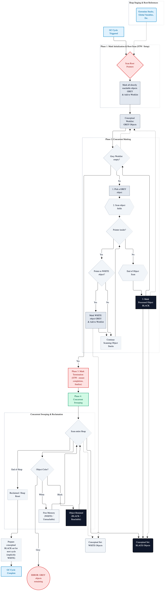

# Chapter 2: Memory Model & Pointers

Welcome to Chapter 2 of the **Go Systems Blueprint**. Having covered basic syntax, variable mechanics, scoping, and numeric precision in Chapter 1, we now transition to the engine driving Go's high-performance runtime: the memory model. 

Building scale distributed infrastructure requires a rigorous understanding of how memory is allocated, accessed, mutated, and reclaimed. In this chapter, we explore value vs. reference semantics, pointer mechanics, stack vs. heap allocation, escape analysis, and the operational behavior of Go’s garbage collector.

---

## 2.1 Pointer Fundamentals and Addressing Mechanics

A pointer stores the physical memory address of a value. Go provides explicit pointers, allowing low-level memory access and direct mutation without the unsafe pointer arithmetic typical of C/C++.

The `&` (address-of) operator retrieves the memory address of a variable, while the `*` (dereference) operator yields the value stored at a pointer's target address.

```go
package main

import "fmt"

func main() {
	// Declare a standard integer value on the stack.
	var clusterNodeCount int = 16

	// Obtain the memory address of clusterNodeCount using the address-of operator (&).
	var nodeCountPointer *int = &clusterNodeCount

	fmt.Printf("Value of clusterNodeCount: %d\n", clusterNodeCount)
	fmt.Printf("Memory address of clusterNodeCount: %p\n", nodeCountPointer)

	// Dereference the pointer using (*) to read the memory location directly.
	fmt.Printf("Value accessed via dereferencing pointer: %d\n", *nodeCountPointer)

	// Mutate the value directly in memory through pointer dereferencing.
	*nodeCountPointer = 32

	// The original variable reflects the mutation because both reference the same address.
	fmt.Printf("Updated clusterNodeCount after pointer mutation: %d\n", clusterNodeCount)
}
```
---

## 2.2 Value Semantics versus Pointer/Reference Semantics

Understanding when to pass values by value (copying data) versus by pointer (sharing memory) is crucial for controlling concurrency safety and allocations in high-throughput applications.

- **Value Semantics (Pass-by-Value):** Go passes everything by value. Passing a variable or struct to a function creates a deep copy of that data. The original variable cannot be mutated by the called function, guaranteeing immutability and thread safety.
- **Pointer Semantics (Pass-by-Pointer):**  Passing a pointer copies the memory address (8 bytes on 64-bit systems), not the underlying structure. This enables direct mutation of the underlying data and avoids heavy copying of large structs.

```go
package main

import "fmt"

type ServerConfiguration struct {
	HostName string
	Port     int
	IsActive bool
}

// UpdateConfigByValue receives a complete copy of ServerConfiguration.
// Modifications inside this function do not mutate the caller's memory.
func UpdateConfigByValue(serverConfiguration ServerConfiguration, newPortNumber int) ServerConfiguration {
	serverConfiguration.Port = newPortNumber

	return serverConfiguration
}

// UpdateConfigByPointer receives a pointer to ServerConfiguration (*ServerConfiguration).
// Modifications directly mutate the memory space of the caller's struct.
func UpdateConfigByPointer(serverConfiguration *ServerConfiguration, newPortNumber int) {
	serverConfiguration.Port = newPortNumber
}

func main() {
	initialServerConfiguration := ServerConfiguration{
		HostName: "node-alpha.internal",
		Port:     8080,
		IsActive: true,
	}

	fmt.Printf("Initial Config: %+v\n", initialServerConfiguration)

	// 1. Pass by Value: original remains unchanged unless explicitly overwritten.
	_ = UpdateConfigByValue(initialServerConfiguration, 9090)

	fmt.Printf("After UpdateConfigByValue: %+v\n", initialServerConfiguration)

	// 2. Pass by Pointer: original is mutated directly across function boundaries.
	UpdateConfigByPointer(&initialServerConfiguration, 9090)

	fmt.Printf("After UpdateConfigByPointer: %+v\n", initialServerConfiguration)
}
```
---

## 2.3 Stack Allocation versus Heap Allocation

Go manages memory across two primary storage areas:
1. **The Stack:**
   - Extremely fast allocation and deallocation (LIFO execution stack frame pointer adjustments).
   - Thread-local (each goroutine maintains its own expandable stack frame, starting at 2KB).
   - Zero Garbage Collector (GC) pressure. Memory is automatically reclaimed when the function returns.

2. **The Heap:**
   - Dynamic global memory space for data that outlives the scope of the function that created it.
   - Managed directly by Go's concurrent Mark-Sweep Garbage Collector.
   - Higher allocation overhead and GC tracking cost.

```go
package main

import "fmt"

// createStackVariable returns a value.
// Memory for 'value' can be safely allocated on the stack frame because it is copied out by value.
func createStackVariable() int {
	value := 42

	return value
}

// createHeapVariable returns a pointer to a locally declared variable.
// Because the pointer outlives createHeapVariable's stack frame, the compiler forces this memory onto the heap.
func createHeapVariable() *int {
	value := 100

	return &value
}

func main() {
	stackValue := createStackVariable()
	heapPointer := createHeapVariable()

	fmt.Printf("Stack value: %d\n", stackValue)
	fmt.Printf("Heap pointer points to value: %d at address: %p\n", *heapPointer, heapPointer)
}
```
---

### 2.4 Escape Analysis Mechanics

Escape analysis is a compile-time pass where the Go compiler inspects code to decide whether memory should reside on the stack or escape to the heap.

### Common Escape Triggers:

1. **Pointers outliving local stack frames:**
   - Returning a pointer to a local variable.

2. **Interface dynamically typed conversions:**
   - Passing concrete values to interface parameters (e.g., `fmt.Println(x)` converts `x` to `any`/`interface{}` causing heap allocation).

3. **Variables exceeding stack size limits:**
   - Allocating large slices or arrays.

4. **Dynamic slice sizing:**
   - Appending data to slices whose capacities are unknown at compile time.

### Compiler Escape Analysis Tooling

You can iinspect compiler decisions using go `build -gcflags="-m"`:

```go
$ go build -gcflags="-m" main.go
# output snippet:
./main.go:15:6: moved to heap: val
./main.go:21:13: ... escapes to heap
```

```go
package main

import "fmt"

type BufferPool struct {
	Capacity int
}

// CreateBuffer escapes to heap because a pointer to a stack-declared struct is returned.
func CreateBuffer(capacity int) *BufferPool {
	bufferInstance := BufferPool{Capacity: capacity} // Escapes to heap!
	return &bufferInstance
}

// ProcessBuffer stays on stack because data flows into the function without returning addresses.
func ProcessBuffer(bufferPoolInstance BufferPool) int {
	return bufferPoolInstance.Capacity * 2
}

func main() {
	// Escapes to heap via pointer return.
	buffer := CreateBuffer(1024)

	// Remains on stack.
	calculatedSize := ProcessBuffer(*buffer)

	// fmt.Printf takes variadic interface{} inputs, forcing buffer and calculatedSize to escape to heap.
	fmt.Printf("Buffer Capacity: %d | Computed Size: %d\n", buffer.Capacity, calculatedSize)
}
```
---

## 2.5 Built-in Memory Allocation: new() versus make()

Go provides two built-in functions for memory allocation: new and make. Mixing up their roles is a common pitfall.

| Feature | `new(T)` | `make(T, args)` |
| :--- | :--- | :--- |
| **Applicable Types** | All types (`int`, `struct`, arrays, etc.) | **Slices, Maps, and Channels only** |
| **Return Type** | Pointer to zeroed memory (`*T`) | Initialized value of type (`T`) |
| **Memory State** | Allocates zero-value memory; does not initialize internal structures | Allocates and initializes internal headers (pointers, lengths, capacities) |

```go
package main

import "fmt"

type MetricsNode struct {
	ID        string
	HitsCount int64
}

func main() {
	// 1. Using new(): Allocates zeroed memory for MetricsNode and returns *MetricsNode.
	node := new(MetricsNode)
	node.ID = "node-01"
	node.HitsCount = 5000

	fmt.Printf("new() output: Type=%T, Address=%p, Value=%+v\n", node, node, node)

	// 2. Using make(): Initializes internal data structures for slices, maps, and channels.
	integerSlice := make([]int, 5, 10)   // Type: []int (len=5, capacity=10).
	connectionMap := make(map[string]int) // Type: map[string]int.
	booleanChannel := make(chan bool, 1)  // Type: chan bool (buffered).

	integerSlice[0] = 100
	connectionMap["active_connections"] = 42
	booleanChannel <- true

	fmt.Printf("make() Slice: len=%d cap=%d\n", len(integerSlice), cap(integerSlice))
	fmt.Printf("make() Map size: %d\n", len(connectionMap))
	fmt.Printf("make() Channel item sent successfully: %t\n", <-booleanChannel)
}
```
---

## 2.6 Garbage Collection Architecture & Memory Tuning

Go uses a concurrent, tri-color mark-sweep garbage collector designed for ultra-low pause times (typically sub-millisecond).

### Tri-Color Marking Algorithm:
- **White Set:** Unvisited objects; candidate memory for collection.
- **Grey Set:** Objects visited by GC, but their referenced objects haven't been scanned yet.
- **Black Set:** Objects visited whose references are fully scanned. Guaranteed reachable.

---

<div align="center">
    <picture>
        <source media="(prefers-color-scheme: dark)" srcset="images/tri-color-marking-algorithm-dark.png">
        
    </picture>
</div>

---

### GC Control and Tuning (GOGC & Memory Limits)

1. **GOGC (Garbage Collector Target Percentage):** Controls GC target trigger size relative to live heap size.
   - Default `GOGC=100` triggers GC when heap grows by 100% since last collection.
   - Higher values (e.g., `GOGC=200`) defer GC, saving CPU at the expense of RAM.
   - Setting `GOGC=off` disables GC entirely.

2. **GOMEMLIMIT (Memory Limit):** Introduced in Go 1.19 to set hard memory limit, preventing Out-Of-Memory (OOM) crashes in containerized evironments (Kubernetes/Docker).

```go
package main

import "fmt"

func main() {
	// Demonstrates manual GC triggers for performance-critical scenarios (e.g., post-initialization).
	fmt.Println("Simulating memory workload...")

	// Pre-allocate a large slice to reduce GC churn.
	telemetryBatch := make([]byte, 10*1024*1024) // 10MB allocation
	telemetryBatch[0] = 0xFF

	fmt.Printf("Allocated %d bytes on heap.\n", len(telemetryBatch))

	// Manual garbage collection trigger (rarely needed in standard production code).
	// runtime.GC()
	fmt.Println("Memory management operations complete.")
}
```
---

## 2.7 Performance Patterns: Zero-allocation System Design

High-performance Go code limits heap allocations to minimize GC pauses and maximize CPU cache locality.

### Memory Optimization Rules:

1. **Preallocate Slices and Maps:** Always supply capacity hints (make([]T, 0, capacity)) to prevent re-allocation copy cascades.
2. **Use sync.Pool for Ephemeral Objects:** Reuse temporary byte buffers or encoding structs across concurrent goroutines.
3. **Prefer Value Receivers for Small Structs:** Small structs (under ~64 bytes) are cheap to copy on the stack, avoiding heap escapes.
4. **Avoid interface{} in Hot Execution Paths:** Abstract interface parameters force dynamic type assertion and escape stack frames to the heap.

```go
package main

import (
	"bytes"
	"fmt"
	"sync"
)

// Global sync.Pool for re-using bytes.Buffer objects to achieve zero heap allocation loops.
var bufferPool = sync.Pool{
	New: func() any {
		return new(bytes.Buffer)
	},
}

func LogPayload(data []byte) {
	// Fetch an existing buffer from the pool.
	buffer := bufferPool.Get().(*bytes.Buffer)
	buffer.Reset() // Reset buffer offsets without reallocating underlying array.

	// Defer returning the buffer to the pool for reuse.
	defer bufferPool.Put(buffer)

	buffer.WriteString("LOG_PREFIX: ")
	buffer.Write(data)

	fmt.Println(buffer.String())
}

func main() {
	payload := []byte("Incoming TCP telemetry frame #8092")
	
	// Re-uses pooled memory buffers without generating GC garbage.
	LogPayload(payload)
	LogPayload(payload)
}
```
---

## Key Takeaways

- **Stack vs. Heap:** Stack allocation is near-zero overhead; heap allocation incurs tracking overhead and GC mark-sweep passes.
	
- **Escape Analysis:** The Go compiler automatically moves variables to the heap when their lifecycle outlives their stack frame or when passed to untyped interfaces.
	
- **Struct Layout Matters:** Grouping fields by size inside structs minimizes alignment padding bytes and reduces overall memory footprints.
	
- **new() vs. make():** new(T) returns *T pointing to zeroed memory. make(T) initializes headers for slices, maps, and channels.
	
- **Garbage Collection Tuning:** GOGC tunes collection frequency relative to heap growth, while GOMEMLIMIT prevents container OOM kills.

- **Zero-Allocation Optimization:** Use sync.Pool and preallocate slice capacities (make([]T, 0, cap)) to eliminate allocation churn in hot loops.
