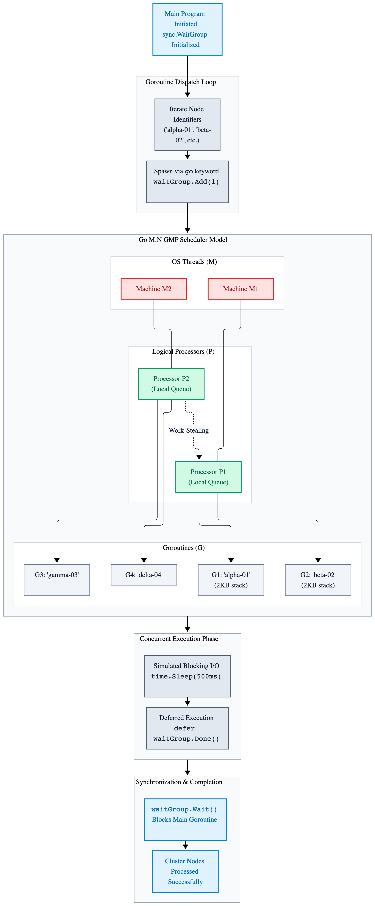

# Chapter 4: Concurrent Telemetry Processing via Goroutine Pool

Welcome to Chapter 4 of the Go Systems Blueprint. In previous chapters, we covered syntax primitives, memory models, heap/stack escape analysis, and explicit error handling. We now enter Go's defining domain: concurrency.

Go was engineered from the ground up for modern multicore cloud infrastructure. Unlike languages that map concurrency directly to heavy OS threads, Go implements the CSP (Communicating Sequential Processes) model, famously summarized by Go proverb: "Do not communicate by sharing memory; instead, share memory by communicating."

In this chapter, we dissect goroutines, the M:N work-stealing scheduler, channel semantics, non-blocking multiplexing, and low-level synchronization primitives.

---

## 4.1 Goroutines and the M:N Scheduler

A goroutine is a lightweight thread of execution managed directly by the Go runtime, not the operating system kernel.

- **Minimal Memory Overhead:** Goroutines start with an initial stack allocation of only 2KB (compared to 1-2MB for OS threads). Stacks grow and shrink dynamically as needed.
- **The M:N Work-Stealing Scheduler:**  The Go runtime uses the G-M-P model to multiplex thousands of goroutines (G) across a pool of OS threads (M) controlled by logical processors (P, typically matching CPU cores):
  - **G (Goroutine):** Represents the unit of concurrent execution and its current stack/instruction pointer.
  - **M (Machine):** Represents an OS thread managed by the kernel scheduler.
  - **P (Processor):**: Represents a logical resource required to execute Go code (running queue of goroutines).
  - **Work-Stealing:**  If an OS thread finishes its local queue of goroutines, it steals work from other processor queues to maximize CPU core utilization.

```go
package main

import (
	"fmt"
	"runtime"
	"sync"
	"time"
)

func ProcessTelemetryNode(nodeID string, waitGroup *sync.WaitGroup) {
	// Ensure the WaitGroup counter decrements when this goroutine exits.
	defer waitGroup.Done()

	fmt.Printf("[Node %s] Telemetry ingestion started on OS thread.\n", nodeID)
	
	// Simulate blocking I/O work.
	time.Sleep(500 * time.Millisecond)

	fmt.Printf("[Node %s] Telemetry ingestion complete.\n", nodeID)
}

func main() {
	fmt.Printf("Logical CPU cores available: %d\n", runtime.NumCPU())
	
	var waitGroup sync.WaitGroup

	nodeIdentifiers := []string{"alpha-01", "beta-02", "gamma-03", "delta-04"}

	for _, nodeID := range nodeIdentifiers {
		waitGroup.Add(1)

		// Launch a concurrent goroutine using the go keyword.
		go ProcessTelemetryNode(nodeID, &waitGroup)
	}

	// Block main execution until all spawned goroutines complete their work.
	waitGroup.Wait()

	fmt.Println("All cluster nodes processed successfully.")
}
```
---

## GMP Model Diagram

This diagram illustrates the architecture of the **Go M:N Scheduler,** commonly known as the **GMP Model** which handles concurrency in the Go programming language.

It shows how lightweight user-space threads (Go routines) are mapped and scheduled onto kernel-level Operating System threads.

---

<p align="center">
  <picture>
    <source media="(prefers-color-scheme: dark)" srcset="images/gmp-model-dark.png">
    
  </picture>
</p>

---

## 4.2 Channels (Unbuffered versus Buffered)

Channels provide a typed conduit through which you can send and receive values with concurrent coroutines.

- **Unbuffered Channels (make(chan T)):** Zero capacity. Sends block until a receiver is ready to take the data, providing strict synchronization (rendezvous point).
- **Buffered Channels (make(chan T, capacity)):** Holds a fixed number of elements. Sends block only when the buffer is full; receives block only when the buffer is empty.

```go
package main

import (
	"fmt"
	"time"
)

// TelemetryPacket defines the data structure for incoming cluster telemetry.
type TelemetryPacket struct {
	SourceID    string
	PayloadSize int
}

// StreamIngestionPipeline generates simulated telemetry packets and pushes them into the channel.
func StreamIngestionPipeline(packetChannel chan<- TelemetryPacket) {
	// Ensure the channel is closed when the generator function finishes execution.
	defer close(packetChannel)

	for index := 1; index <= 3; index++ {
		// Construct a telemetry packet with a unique source identifier and payload size.
		packet := TelemetryPacket{
			SourceID:    fmt.Sprintf("sensor-%d", index),
			PayloadSize: index * 256,
		}
		
		fmt.Printf("Producing packet from %s...\n", packet.SourceID)

		// Send the packet into the channel, blocking if the buffer capacity is reached.
		packetChannel <- packet

		// Pause briefly between packet generation iterations.
		time.Sleep(200 * time.Millisecond)
	}
}

func main() {
	// Instantiate a buffered channel capable of holding up to 2 telemetry packets.
	packetChannel := make(chan TelemetryPacket, 2)

	// Launch the stream ingestion pipeline in a concurrent background goroutine.
	go StreamIngestionPipeline(packetChannel)

	// Iterate over the channel to consume packets until the channel is closed and drained.
	for receivedPacket := range packetChannel {
		fmt.Printf("Consumed Packet -> Source: %s, Size: %d bytes\n", 
			receivedPacket.SourceID, receivedPacket.PayloadSize)
	}

	fmt.Println("Ingestion pipeline channel closed and drained.")
}
```
---

## 4.3 Select Statements & Non-Blocking Multiplexing

The `select` statement enables a goroutine to wait on multiple channel operations simultaneously, resembling a `switch` statement tailored specifically for channel communications.

- **Non-Blocking Operations:** By pairing `select` with a `default` case, you can attempt to send or receive on a channel without blocking execution if the channel is unready.
- **Timeouts:** Easily implement hard timeouts using `time.After()`.

```go
package main

import (
	"fmt"
	"time"
)

// QueryDatabaseCluster simulates querying a specific database node with variable latency.
func QueryDatabaseCluster(nodeEndpoint string, acknowledgmentStream chan<- string) {
	// Initialize the baseline propagation delay for standard node operations.
	propagationDelay := 100 * time.Millisecond

	// Inject simulated replication lag if targeting a slow replica shard.
	if nodeEndpoint == "shard-replica-lagging" {
		propagationDelay = 800 * time.Millisecond
	}

	// Simulate blocking network transmission and query execution overhead.
	time.Sleep(propagationDelay)
	
	// Push the formatted node acknowledgment back through the output stream.
	acknowledgmentStream <- fmt.Sprintf("Acknowledgment from %s", nodeEndpoint)
}

func main() {
	// Instantiate buffered communication channels for each concurrent cluster target.
	edgeNodeChan := make(chan string, 1)
	archivalNodeChan := make(chan string, 1)

	// Launch concurrent query routines against the primary and archival nodes.
	go QueryDatabaseCluster("shard-primary-us-east", edgeNodeChan)
	go QueryDatabaseCluster("shard-replica-lagging", archivalNodeChan)

	// Multiplex channel responses using a select statement to enforce a strict SLA timeout.
	select {
	case streamResult := <-edgeNodeChan:
		// Handle successful response from the primary edge node.
		fmt.Printf("Primary Shard Success: %s\n", streamResult)
	case streamResult := <-archivalNodeChan:
		// Handle successful response from the archival replica node.
		fmt.Printf("Archival Replica Success: %s\n", streamResult)
	case <-time.After(300 * time.Millisecond):
		// Trigger fallback logic if response latency breaches the 300ms SLA threshold.
		fmt.Println("CRITICAL TIMEOUT: Database cluster response exceeded SLA limit.")
	}
}
```
---

## 4.4 Synchronization Primitives (sync Package)

While channels excel at passing data ownership between goroutines, low-level synchronization primitives from the sync package manage shared state and memory protection.

- `sync.WaitGroup`: Blocks execution until a designated counter drops to zero.
- `sync.Mute`x and sync.RWMutex: Mutual exclusion locks. Mutex grants exclusive access, while RWMutex allows multiple concurrent readers or a single exclusive writer.
- `sync/atomic`: Hardware-level atomic operations for lock-free counter updates.

```go
package main

import (
	"fmt"
	"sync"
	"sync/atomic"
)

// ConcurrentMetricAggregator manages thread-safe metric counts using both mutexes and atomic operations.
type ConcurrentMetricAggregator struct {
	mutexLock           sync.Mutex
	mutexProtectedTotal int64
	lockFreeAtomicTotal int64
}

// IncrementMetrics safely increments both the mutex-protected and atomic metric counters concurrently.
func (aggregator *ConcurrentMetricAggregator) IncrementMetrics(taskWaitGroup *sync.WaitGroup) {
	// Ensure the wait group counter decrements when this worker finishes execution.
	defer taskWaitGroup.Done()

	// 1. Acquire the mutex lock to safely protect the critical section and increment the counter.
	aggregator.mutexLock.Lock()
	aggregator.mutexProtectedTotal++
	aggregator.mutexLock.Unlock()

	// 2. Perform a hardware-level lock-free atomic increment on the concurrent counter.
	atomic.AddInt64(&aggregator.lockFreeAtomicTotal, 1)
}

func main() {
	// Instantiate a wait group to coordinate worker goroutine lifecycles.
	var taskWaitGroup sync.WaitGroup
	
	// Declare an instance of the concurrent metric aggregator.
	var metricAggregator ConcurrentMetricAggregator

	// Define the total number of concurrent worker goroutines to spawn.
	telemetryWorkerTotal := 1000

	// Spawn multiple concurrent workers to increment metrics simultaneously.
	for workerIterationIndex := 0; workerIterationIndex < telemetryWorkerTotal; workerIterationIndex++ {
		taskWaitGroup.Add(1)
		go metricAggregator.IncrementMetrics(&taskWaitGroup)
	}

	// Block main execution until all worker goroutines complete their increments.
	taskWaitGroup.Wait()

	// Print the final accumulated totals from both synchronization strategies.
	fmt.Printf("Final Mutex Protected Total: %d\n", metricAggregator.mutexProtectedTotal)
	fmt.Printf("Final Atomic Counter Total: %d\n", metricAggregator.lockFreeAtomicTotal)
}
```
---

## 4.5 Context Propagation and Cancellation

In distributed systems, operations often span multiple goroutines and network boundaries. If a request exceeds its deadline, continuing to process background work wastes compute resources.

Go solves this via the context package, which carries deadlines, cancellation signals, and request-scoped values across API boundaries.

```go
package main

import (
	"context"
	"errors"
	"fmt"
	"time"
)

// ExecuteRemoteTelemetryQuery simulates fetching remote data with a simulated delay and context cancellation support.
func ExecuteRemoteTelemetryQuery(ctx context.Context, queryID string, resultChannel chan<- string) {
	// Define the simulated network processing duration.
	processingDuration := 600 * time.Millisecond
	
	// Initialize a timer to simulate background processing latency.
	simulationTimer := time.NewTimer(processingDuration)
	defer simulationTimer.Stop()

	// Multiplex between context cancellation and query completion.
	select {
	case <-ctx.Done():
		// Handle context cancellation or deadline expiration.
		fmt.Printf("[Query %s] Aborted: %v\n", queryID, ctx.Err())
		return
	case <-simulationTimer.C:
		// Send the simulated data bundle back through the result channel.
		resultChannel <- fmt.Sprintf("Data bundle for query %s", queryID)
	}
}

func main() {
	// Create a root context with a strict 300ms timeout to enforce an SLA limit.
	rootContext, cancelContext := context.WithTimeout(context.Background(), 300*time.Millisecond)

	// Ensure the cancel function is called to release resources when main exits.
	defer cancelContext()

	// Instantiate a buffered channel to receive the remote query result.
	resultChannel := make(chan string, 1)

	// Launch the remote telemetry query in a background goroutine.
	go ExecuteRemoteTelemetryQuery(rootContext, "q-9901", resultChannel)

	// Multiplex between receiving the query result and hitting the context timeout.
	select {
	case queryResult := <-resultChannel:
		// Handle successful data retrieval within the SLA window.
		fmt.Printf("Success: %s\n", queryResult)
	case <-rootContext.Done():
		// Check if the request failed due to a deadline breach.
		if errors.Is(rootContext.Err(), context.DeadlineExceeded) {
			fmt.Println("Client Error: Request exceeded SLA deadline limit.")
		}
	}
}
```
---

## 4.6 Goroutine Leaks and Race Detection

A **goroutine leak** occurs when a goroutine sits blocked indefinitely on a channel or synchronization primitive, retaining its stack memory for the application's lifetime.

Always ensure worker goroutines have explicit cancellation paths, and use Go's built-in race detector to catch memory corruption during testing:

`go test -race ./...`

```go
package main

import (
	"fmt"
	"runtime"
	"time"
)

// LeakProneWorker runs a continuous background loop that listens for a shutdown signal on the control channel.
func LeakProneWorker(controlChannel <-chan struct{}) {
	for {
		// Multiplex between checking for a shutdown signal and executing background work.
		select {
		case <-controlChannel:
			// Handle the shutdown signal and exit the worker goroutine cleanly.
			fmt.Println("Worker received shutdown signal. Exiting.")
			return
		default:
			// Simulate periodic background task processing when no signal is received.
			time.Sleep(100 * time.Millisecond)
		}
	}
}

func main() {
	// Instantiate an unbuffered control channel used to broadcast shutdown signals.
	controlChannel := make(chan struct{})

	// Launch the worker goroutine in the background.
	go LeakProneWorker(controlChannel)

	// Allow the background worker to run briefly.
	time.Sleep(250 * time.Millisecond)

	// Print the active goroutine count before initiating worker shutdown.
	fmt.Printf("Goroutines active before shutdown: %d\n", runtime.NumGoroutine())

	// Close the control channel to broadcast the shutdown signal to the worker.
	close(controlChannel)

	// Allow a brief moment for the worker goroutine to terminate and clean up.
	time.Sleep(50 * time.Millisecond)

	// Print the active goroutine count after shutdown to confirm no leaks occurred.
	fmt.Printf("Goroutines active after shutdown: %d\n", runtime.NumGoroutine())
}
```
---

## 4.7 High-Performance Memory Pooling (sync.Pool)

In high-throughput concurrent systems, allocating temporary buffers for every incoming request places heavy pressure on the garbage collector. sync.Pool provides a concurrent-safe object-recycling cache to minimize heap allocations.

```go
package main

import (
	"bytes"
	"fmt"
	"sync"
)

// bufferPool provides a concurrent-safe object-recycling cache for byte buffers to minimize heap allocations.
var bufferPool = sync.Pool{
	New: func() interface{} {
		// Allocate a new byte buffer if the pool is currently empty.
		return new(bytes.Buffer)
	},
}

// ProcessPayload retrieves a recycled buffer from the pool, formats the input data, and returns the result.
func ProcessPayload(inputData string) string {
	// Retrieve a reusable byte buffer from the pool and type-assert it to *bytes.Buffer.
	buffer := bufferPool.Get().(*bytes.Buffer)
	
	// Reset the buffer to clear any stale content left from previous usage.
	buffer.Reset()

	// Ensure the buffer is returned to the pool when function execution finishes.
	defer bufferPool.Put(buffer)

	// Write the processing header prefix into the buffer.
	buffer.WriteString("[Processed] ")
	
	// Append the raw input telemetry data into the buffer.
	buffer.WriteString(inputData)

	// Return the finalized string representation of the buffer contents.
	return buffer.String()
}

func main() {
	// Define a slice of sample telemetry payload strings for testing.
	payloads := []string{"sensor-stream-alpha", "sensor-stream-beta", "sensor-stream-gamma"}

	// Iterate through each payload to process it using the memory-pooled function.
	for _, payload := range payloads {
		result := ProcessPayload(payload)
		fmt.Println(result)
	}

	fmt.Println("Telemetry payloads processed via recycled memory pool.")
}
```

### Key Takeaways

- **G-M-P Scheduler:**  Go achieves high-performance concurrency by multiplexing lightweight goroutines (G) with tiny 2KB starting stacks across OS threads (M) and logical processors (P) using a dynamic work-stealing engine.

- **CSP Principals:** Adhere to the core Go proverb—"Do not communicate by sharing memory; instead, share memory by communicating," using typed channels as conduits for safe data handoffs.

- **Buffered vs. Unbuffered Channels:** Unbuffered channels enforce strict rendezvous synchronization, whereas buffered channels introduce bounded elasticity to decouple producer-consumer throughput rates.

- **Multiplexing with Select:** Use `select` statement to coordinate multiple channel operations concurrently, pair with `time.After` to enforce strict SLAs, and utilize `default` clauses for non-blocking probes.

- **Granular Synchronization:** Leverage sync.WaitGroup for lifecycle coordination, sync.Mutex for protecting critical state sections, and sync/atomic for low-level lock-free counters.

- **Context-Driven Cancellations:** Pass `context.Context` down call stacks to propagate cancellation signals, prevent abandoned work, and enforce hard timeouts across distributed operations.

- **Lifecycle Governance & Diagnostics:**  Guard against silent goroutine leaks caused by blocked channels, and always integrate Go's built-in race detector (go test -race) into your testing pipelines.

- **Transient Allocation Pooling:** Utilize sync.Pool to recycle temporary heap allocations and significantly mitigate garbage collection pause pressure in high-throughput loops.
