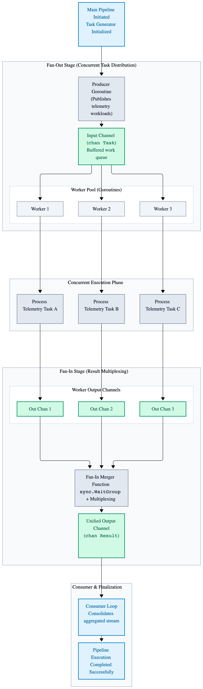
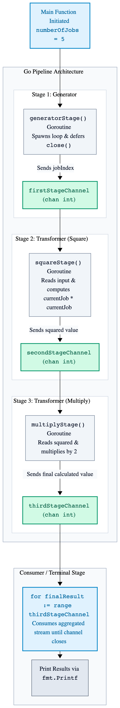
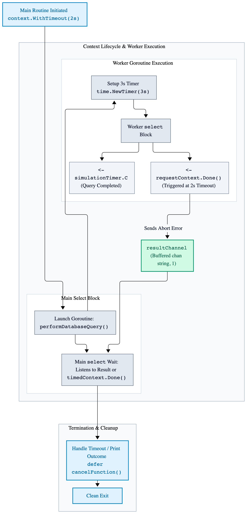
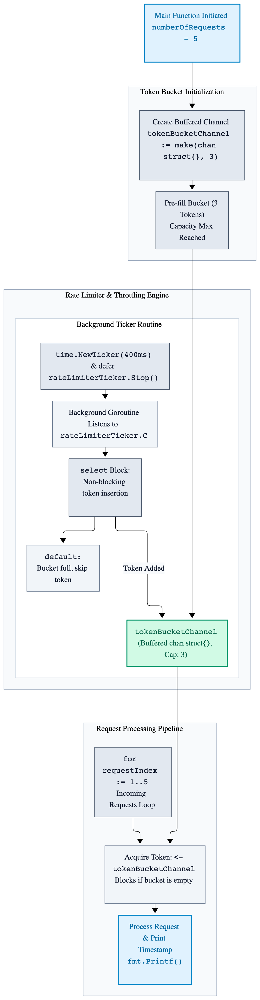

# Chapter 5: Advanced Concurrency Patterns

Building upon the Go M:N Scheduler (GMP model) and core primitives (goroutines and channels), advanced concurrency patterns allow you to build robust, scalable, and high-performance concurrent applications. This guide covers essential patterns, implementation strategies, and best practices for avoiding common pitfalls like goroutine leaks and race conditions.

## 5.1 Worker Pool Pattern

When dealing with a massive number of tasks (e.g., thousands of incoming HTTP requests or file processing jobs), spawning a new goroutine for every single task can overwhelm the scheduler and exhaust memory. A **Worker Pool** limits the number of concurrently executing goroutines to a fixed pool size.

```go
package main

import (
	"fmt"
	"sync"
	"time"
)

func worker(workerIndex int, jobChannel <-chan int, resultChannel chan<- int, waitGroup *sync.WaitGroup) {
	defer waitGroup.Done()

	for currentJob := range jobChannel {
		fmt.Printf("Worker %d started job %d\n", workerIndex, currentJob)

		time.Sleep(time.Millisecond * 500) // Simulate heavy work.
		resultChannel <- currentJob * 2

		fmt.Printf("Worker %d finished job %d\n", workerIndex, currentJob)
	}
}

func main() {
	const numberOfJobs = 5
	const numberOfWorkers = 3

	jobChannel := make(chan int, numberOfJobs)
	resultChannel := make(chan int, numberOfJobs)

	var waitGroup sync.WaitGroup

	// Start workers.
	for workerIndex := 1; workerIndex <= numberOfWorkers; workerIndex++ {
		waitGroup.Add(1)
		go worker(workerIndex, jobChannel, resultChannel, &waitGroup)
	}

	// Send jobs.
	for jobIndex := 1; jobIndex <= numberOfJobs; jobIndex++ {
		jobChannel <- jobIndex
	}

	close(jobChannel) // Signal workers that no more jobs are coming.

	// Wait for all workers to finish and close results.
	waitGroup.Wait()
	close(resultChannel)

	// Collect results.
	for processedResult := range resultChannel {
		fmt.Printf("Result: %d\n", processedResult)
	}
}
```
---

## 5.2 Fan-Out / Fan-In Pattern

- **Fan Out:** Multiple goroutines read concurrently from a shared input channel. Go's channel semantics naturally handle load distribution: whichever worker becomes available first grabs the next available unit of work from the queue. This prevents bottlenecks and maximizes throughput.
- **Fan In:** Multiple discrete output channels produced by individual workers are merged into a single consolidated channel. This allows a downstream consumer to range over a single unified stream without needing to manage multiple channels manually.

```go
package main

import (
	"fmt"
	"sync"
	"time"
)

// generator creates the initial stream of raw data (Fan-Out source).
func generator(numberOfJobs int) <-chan int {
	outChannel := make(chan int, numberOfJobs)
	go func() {
		defer close(outChannel)

		for jobIndex := 1; jobIndex <= numberOfJobs; jobIndex++ {
			outChannel <- jobIndex
		}
	}()

	return outChannel
}

// worker processes items from the input channel (Fan-Out workers).
func worker(workerIndex int, inputStream <-chan int) <-chan int {
	outputStream := make(chan int)

	go func() {
		defer close(outputStream)

		for currentJob := range inputStream {
			fmt.Printf("Worker %d processing job %d\n", workerIndex, currentJob)
			time.Sleep(time.Millisecond * 400) // Simulate processing time.

			outputStream <- currentJob * 2     // Transformation step.
		}
	}()

	return outputStream
}

// merge multiplexes multiple worker channels into a single unified channel (Fan-In).
func merge(channels ...<-chan int) <-chan int {
	var waitGroup sync.WaitGroup
	unifiedStream := make(chan int)

// Internal function to copy values from a worker channel to the unified stream.
	output := func(ch <-chan int) {
		defer waitGroup.Done()

		for value := range ch {
			unifiedStream <- value
		}
	}

	waitGroup.Add(len(channels))

	for _, channel := range channels {
		go output(channel)
	}

	// Goroutine to close the unified stream once all workers have finished.
	go func() {
		waitGroup.Wait()
		close(unifiedStream)
	}()

	return unifiedStream
}

func main() {
	const numberOfJobs = 6
	const numberOfWorkers = 3

	// 1. Setup Producer Stage.
	rawJobs := generator(numberOfJobs)

	// 2. Fan-Out: Spawn multiple worker goroutines reading from the same input.
	var workerChannels []<-chan int

	for workerIndex := 1; workerIndex <= numberOfWorkers; workerIndex++ {
		workerChannels = append(workerChannels, worker(workerIndex, rawJobs))
	}

	// 3. Fan-In: Merge all worker output channels into a single stream.
	finalResults := merge(workerChannels...)

	// 4. Consume the unified stream.
	for processedResult := range finalResults {
		fmt.Printf("Received Result: %d\n", processedResult)
	}
}
```

---

<p align="center">
  <picture>
    <source media="(prefers-color-scheme: dark)" srcset="images/worker-pool-concurrency-dark.png">
    
  </picture>
</p>

---

## 5.3 Pipeline Pattern

A pipeline is a series of stages connected by channels, where each stage is a group of goroutines running the same function. Data flows downstream through each transformation step.

```go
package main

import (
	"fmt"
)

// generatorStage produces the initial stream of numbers.
func generatorStage(numberOfJobs int) <-chan int {
	outChannel := make(chan int)

	go func() {
		// Ensure the channel closes when the generator finishes sending jobs.
		defer close(outChannel)

		for jobIndex := 1; jobIndex <= numberOfJobs; jobIndex++ {
			outChannel <- jobIndex
		}
	}()

	return outChannel
}

// squareStage reads numbers from the input channel, squares them, and sends them downstream.
func squareStage(inputStream <-chan int) <-chan int {
	outChannel := make(chan int)

	go func() {
		// Ensure the output channel closes when all input values are processed.
		defer close(outChannel)

		for currentJob := range inputStream {
			outChannel <- currentJob * currentJob
		}
	}()

	return outChannel
}

// multiplyStage reads squared numbers, multiplies them by two, and sends them downstream.
func multiplyStage(inputStream <-chan int) <-chan int {
	outChannel := make(chan int)

	go func() {
		// Ensure the output channel closes when all input values are processed.
		defer close(outChannel)

		for currentJob := range inputStream {
			outChannel <- currentJob * 2
		}
	}()

	return outChannel
}

func main() {
	const numberOfJobs = 5

	// Stage 1: Generate the raw input data stream.
	firstStageChannel := generatorStage(numberOfJobs)

	// Stage 2: Transform raw numbers by squaring them.
	secondStageChannel := squareStage(firstStageChannel)

	// Stage 3: Transform squared numbers by multiplying them by two.
	thirdStageChannel := multiplyStage(secondStageChannel)

	// Consume and print the final results from the pipeline terminal.
	for finalResult := range thirdStageChannel {
		fmt.Printf("Pipeline Result: %d\n", finalResult)
	}
}
```
---

<p align="center">
  <picture>
    <source media="(prefers-color-scheme: dark)" srcset="images/pipeline-pattern-dark.png">
    
  </picture>
</p>

---

## 5.4 Context Cancellation & Timeout Propagation

Using the `context` package is vital for controlling execution lifecycles. It ensures that when a parent operation is canceled, times out, or fails, all child goroutines are instantly notified to abort their work and free up resources.

```go
package main

import (
	"context"
	"fmt"
	"time"
)

// performDatabaseQuery simulates a long-running operation that respects context cancellation.
func performDatabaseQuery(requestContext context.Context, operationDuration time.Duration, resultChannel chan<- string) {
	// Simulate work using a time delay channel.
	simulationTimer := time.NewTimer(operationDuration)

	defer simulationTimer.Stop()

	select {
	case <-requestContext.Done():
		// The context was canceled, timed out, or parent finished. Abort work immediately.
		resultChannel <- fmt.Sprintf("Operation aborted: %v", requestContext.Err())

		return
	case <-simulationTimer.C:
		// The operation completed successfully before any timeout occurred.
		resultChannel <- "Operation completed successfully."

		return
	}
}

func main() {
	// Define a timeout duration for the operation lifecycle.
	const operationTimeout = time.Second * 2

	// Create a parent background context.
	parentContext := context.Background()

	// Derive a child context that automatically cancels after the specified timeout.
	timedContext, cancelFunction := context.WithTimeout(parentContext, operationTimeout)

	// Ensure resources associated with this context are released when main exits.
	defer cancelFunction()

	// Create a channel to receive the operation result.
	resultChannel := make(chan string, 1)

	// Simulate a task that takes longer than the timeout threshold (e.g., 3 seconds).
	const simulatedWorkDuration = time.Second * 3

	// Launch the worker goroutine passing the timed context.
	go performDatabaseQuery(timedContext, simulatedWorkDuration, resultChannel)

	// Wait for either the operation result or the context cancellation signal.
	select {
	case operationResult := <-resultChannel:
		// Print the outcome received from the worker goroutine.
		fmt.Println(operationResult)
	case <-timedContext.Done():
		// Handle the timeout event triggered by the context deadline.
		fmt.Printf("Main routine detected timeout: %v\n", timedContext.Err())
	}

	// Give background goroutines a brief moment to clean up logs before termination.
	time.Sleep(time.Millisecond * 100)
}
```
---

<p align="center">
  <picture>
    <source media="(prefers-color-scheme: dark)" srcset="images/context-cancellation-and-timeout-dark.png">
    
  </picture>
</p>

---

## 5.5 Rate Limiting & Throttling

Controlling throughput prevents services from being overwhelmed. Using time.Ticker or buffered channels enables leaky bucket or token bucket rate limiting.

```go
package main

import (
	"fmt"
	"time"
)

func main() {
	const numberOfRequests = 5

	// Create a buffered channel to hold available tokens for rate limiting.
	tokenBucketChannel := make(chan struct{}, 3)

	// Fill the token bucket initially up to its maximum capacity.
	for tokenIndex := 0; tokenIndex < 3; tokenIndex++ {
		tokenBucketChannel <- struct{}{}
	}

	// Start a background ticker to refill tokens at a fixed interval.
	rateLimiterTicker := time.NewTicker(time.Millisecond * 400)

	// Ensure the ticker resources are released when main exits.
	defer rateLimiterTicker.Stop()

	// Refill tokens concurrently in the background.
	go func() {
		for range rateLimiterTicker.C {
			select {
			case tokenBucketChannel <- struct{}{}:
				// Successfully added a token back to the bucket.
			default:
				// Token bucket is already full, skip adding new token.
			}
		}
	}()

	// Simulate handling incoming requests subject to rate limiting.
	for requestIndex := 1; requestIndex <= numberOfRequests; requestIndex++ {
		// Wait to acquire a token from the bucket before processing the request.
		<-tokenBucketChannel

		fmt.Printf("Processing request %d at %v\n", requestIndex, time.Now().Format("15:04:05.000"))
	}
}
```
---

<p align="center">
  <picture>
    <source media="(prefers-color-scheme: dark)" srcset="images/rate-limiter-dark.png">
    
  </picture>
</p>

---

## 5.6 Best Practices & Common Pitfalls

1. **Never start a goroutine without knowing how it will stop.** (Prevent goroutine leaks).
2. **Always close channels from the sender side**, never the receiver side.
3. **Use the race detector** (`go test -race / go run -race`) during development and testing.

