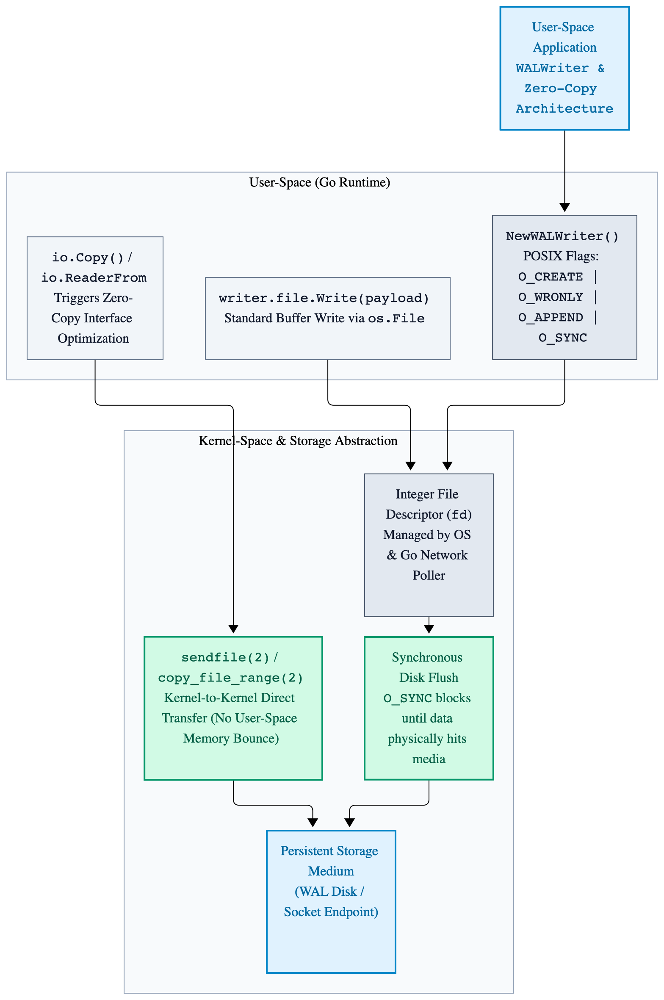
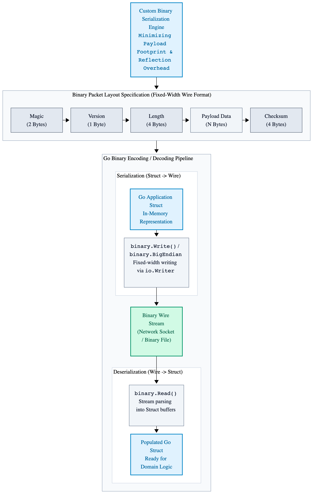
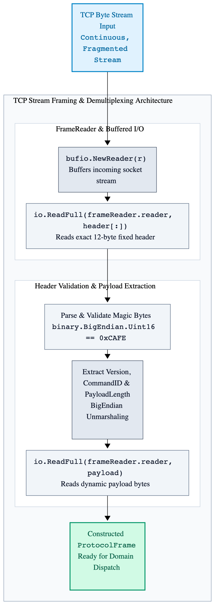

# Chapter 6: Systems I/O & Data Serialization

Systems I/O in Go bridges user-space code with kernel-level abstraction. Writing high-throughput infrastructure requires understanding how Go’s runtime interfaces with file descriptors, standard POSIX system calls, memory-mapped files, and binary wire formats.

This chapter covers POSIX I/O semantics, zero-copy socket transfers, custom binary serialization, stream multiplexing, and memory allocation optimization during serialization workflows.

---

## 1. Operating System Primitives & File Descriptor Semantics

At the operating system level, files, sockets, pipes, and devices are represented as integer file descriptors (`fd`). Go encapsulates file descriptors inside the `os.File` struct, integrating them into the runtime's asynchronous network poller (`netpoller`) when operating in non-blocking mode.

### 6.1 Direct OS File Operations and Flags

Understanding system call flags like `O_DIRECT`, `O_SYNC`, and `O_APPEND` is critical when designing database engines or write-ahead logs (WAL).

```go
package main

import (
	"fmt"
	"os"
	"syscall"
)

// WALWriter provides low-level file write capabilities bypassing page caches where necessary.
type WALWriter struct {
	file *os.File
}

// NewWALWriter opens a file with explicit POSIX sync flags for durable writes.
func NewWALWriter(filepath string) (*WALWriter, error) {
	// O_CREATE: Create file if missing.
	// O_WRONLY: Write-only access.
	// O_APPEND: Append all writes to the end of the file.
	// O_SYNC: Synchronous I/O; writes block until data is physically flushed to disk.
	flags := os.O_CREATE | os.O_WRONLY | os.O_APPEND | syscall.O_SYNC

	file, err := os.OpenFile(filepath, flags, 0644)

	if err != nil {
		return nil, fmt.Errorf("failed to open file %s: %w", filepath, err)
	}

	return &WALWriter{file: file}, nil
}

// WriteRecord appends payload bytes directly to the storage medium.
func (writer *WALWriter) WriteRecord(payload []byte) (int, error) {
	numberOfBytes, err := writer.file.Write(payload)

	if err != nil {
		return numberOfBytes, fmt.Errorf("failed to write payload: %w", err)
	}

	return numberOfBytes, nil
}

// Close gracefully releases the file descriptor.
func (writer *WALWriter) Close() error {
	if err := writer.file.Close(); err != nil {
		return fmt.Errorf("failed to close file descriptor: %w", err)
	}

	return nil
}
```
---

## 6.2 Zero-Copy I/O mechanics: io.Copy & sendfile(2)

Traditional data transfers between file descriptors involve moving memory from kernel space to user-space buffers and back to kernel space. Go optimizes this via the `io.WriterFrom` and `io.ReaderFrom` interfaces, utilizing kernel-level system calls such as `sendfile(2)` or `copy_file_range(2)` when available.

---

<p align="center">
  <picture>
    <source media="(prefers-color-scheme: dark)" srcset="images/traditional-io-path-versus-the-zero-copy-path-dark.png">
    
  </picture>
</p>

---

## 6.3 High-Performance Disk-to-Socket Transfer

```go
package main

import (
	"fmt"
	"io"
	"net"
	"os"
)

// StreamFileToSocket transfers a local file over a TCP connection using zero-copy semantics.
func StreamFileToSocket(filePath string, conn net.Conn) (int64, error) {
	file, err := os.Open(filePath)

	if err != nil {
		return 0, fmt.Errorf("failed to open source file: %w", err)
	}

	defer file.Close()

	// io.Copy automatically checks if the destination implements io.ReaderFrom
	// or if the source implements io.WriterTo.
	// Under Linux TCP connections, this leverages the sendfile(2) system call.
	bytesSent, err := io.Copy(conn, file)

	if err != nil {
		return bytesSent, fmt.Errorf("zero-copy file transfer failed: %w", err)
	}

	return bytesSent, nil
}
```
---

## 6.4 Custom Binary Serialization Engine

Text-based formats like JSON or XML introduce parsing overhead and memory allocations. For high-performance distributed systems, custom fixed-width binary encoding minimizes payload footprint and CPU cycles spent on reflection.

---

<p align="center">
  <picture>
    <source media="(prefers-color-scheme: dark)" srcset="images/binary-packet-layout-diagram-dark.png">
    
  </picture>
</p>

---

### Implementing the Custom Binary Protocol Encoder

```go
package main

import (
	"encoding/binary"
	"errors"
	"fmt"
	"io"
)

// ProtocolFrame defines the fixed-width binary header and payload structure.
type ProtocolFrame struct {
	Magic     uint16
	Version   uint16
	CommandID uint32
	Payload   []byte
}

// ErrInvalidMagic indicates that the incoming stream contains an unrecognized magic number.
var ErrInvalidMagic = errors.New("invalid protocol magic bytes")

// WriteBinaryFrame serializes the protocol frame directly into the provided writer without heap allocations.
func WriteBinaryFrame(writer io.Writer, frame *ProtocolFrame) error {
	// Allocate a fixed-size header buffer on the stack or inline to avoid heap escape where possible.
	header := [12]byte{}

	binary.BigEndian.PutUint16(header[0:2], frame.Magic)
	binary.BigEndian.PutUint16(header[2:4], frame.Version)
	binary.BigEndian.PutUint32(header[4:8], frame.CommandID)
	binary.BigEndian.PutUint32(header[8:12], uint32(len(frame.Payload)))

	// Write the 12-byte header.
	if _, err := writer.Write(header[:]); err != nil {
		return fmt.Errorf("failed to write binary frame header: %w", err)
	}

	// Write the variable-length payload bytes.
	if len(frame.Payload) > 0 {
		if _, err := writer.Write(frame.Payload); err != nil {
			return fmt.Errorf("failed to write binary frame payload: %w", err)
		}
	}

	return nil
}

// ReadBinaryFrame parses a protocol frame from the given reader, enforcing strict structural validation.
func ReadBinaryFrame(reader io.Reader) (*ProtocolFrame, error) {
	header := [12]byte{}

	if _, err := io.ReadFull(reader, header[:]); err != nil {
		return nil, fmt.Errorf("failed to read binary frame header: %w", err)
	}

	magic := binary.BigEndian.Uint16(header[0:2])

	if magic != 0xCAFE {
		return nil, fmt.Errorf("%w: expected 0xCAFE, got 0x%X", ErrInvalidMagic, magic)
	}

	version := binary.BigEndian.Uint16(header[2:4])
	commandID := binary.BigEndian.Uint32(header[4:8])
	payloadLength := binary.BigEndian.Uint32(header[8:12])

	payload := make([]byte, payloadLength)

	if payloadLength > 0 {
		if _, err := io.ReadFull(reader, payload); err != nil {
			return nil, fmt.Errorf("failed to read binary frame payload: %w", err)
		}
	}

	return &ProtocolFrame{
		Magic:     magic,
		Version:   version,
		CommandID: commandID,
		Payload:   payload,
	},
}
```
---

## 6.5 Memory Allocation Optimization with `sync.Pool`

In high-throughput distributed servers handling thousands of concurrent connections, allocating new byte slices for every incoming or outgoing binary frame causes significant pressure on the Go garbage collector (GC).
To eliminate allocation overhead during serialization and deserialization, infrastructure engineers utilize sync.Pool to recycle byte buffers across request lifecycles.

```go
package main

import (
	"sync"
)

// BufferPool manages a reusable pool of byte slices to minimize garbage collection latency.
type BufferPool struct {
	pool sync.Pool
}

// NewBufferPool initializes a buffer pool with a specified default slice capacity.
func NewBufferPool(size int) *BufferPool {
	return &BufferPool{
		pool: sync.Pool{
			New: func() interface{} {
				return make([]byte, 0, size)
			},
		},
	}
}

// Get retrieves a pre-allocated byte slice from the pool and resets its length to zero.
func (bufferPool *BufferPool) Get() []byte {
	buffer := bufferPool.pool.Get().([]byte)
	return buffer[:0]
}

// Put returns a byte slice back to the pool for subsequent reuse.
func (bufferPool *BufferPool) Put(buffer []byte) {
	// Prevent excessively large buffers from bloating memory retention inside the pool.
	if cap(buffer) > 65536 {
		return
	}

	bufferPool.pool.Put(buffer)
}
```
---

## 6.6 TCP Stream Framing and Stream Demultiplexing

The  Transmission Control Protocol (TCP) operates as a continuous byte stream without inherent message boundaries, binary frame parsers must gracefully handle partial reads, packet fragmentation, and socket coalescing. To process incoming frames reliably, production infrastructure implements a dedicated frame-reader abstraction wrapping buffered I/O.

```go
package main

import (
	"bufio"
	"encoding/binary"
	"fmt"
	"io"
)

// FrameReader provides buffered stream reading capabilities to demultiplex incoming TCP binary frames.
type FrameReader struct {
	reader *bufio.Reader
}

// NewFrameReader initializes a new frame reader with an underlying buffered reader.
func NewFrameReader(r io.Reader) *FrameReader {
	return &FrameReader{
		reader: bufio.NewReader(r),
	}
}

// ReadNextFrame reads and validates the next sequential protocol frame from the TCP stream.
func (frameReader *FrameReader) ReadNextFrame() (*ProtocolFrame, error) {
	header := [12]byte{}

	if _, err := io.ReadFull(frameReader.reader, header[:]); err != nil {
		return nil, fmt.Errorf("failed to read protocol frame header: %w", err)
	}

	magic := binary.BigEndian.Uint16(header[0:2])
	if magic != 0xCAFE {
		return nil, fmt.Errorf("invalid magic bytes encountered: 0x%X", magic)
	}

	version := binary.BigEndian.Uint16(header[2:4])
	commandID := binary.BigEndian.Uint32(header[4:8])
	payloadLength := binary.BigEndian.Uint32(header)

	payload := make([]byte, payloadLength)

	if payloadLength > 0 {
		if _, err := io.ReadFull(frameReader.reader, payload); err != nil {
			return nil, fmt.Errorf("failed to read protocol frame payload: %w", err)
		}
	}

	return &ProtocolFrame{
		Magic:     magic,
		Version:   version,
		CommandID: commandID,
		Payload:   payload,
	},
}
```
---

<p align="center">
  <picture>
    <source media="(prefers-color-scheme: dark)" srcset="images/tcp-stream-framing-and-demultiplexing-architecture-dark.png">
    
  </picture>
</p>

---
