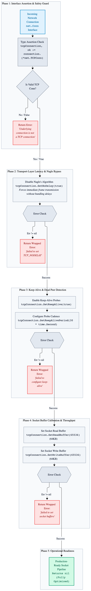
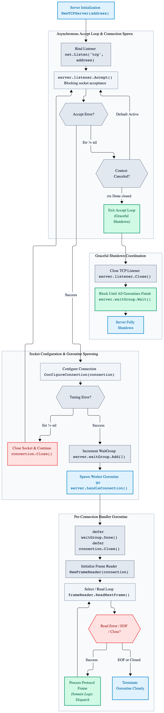
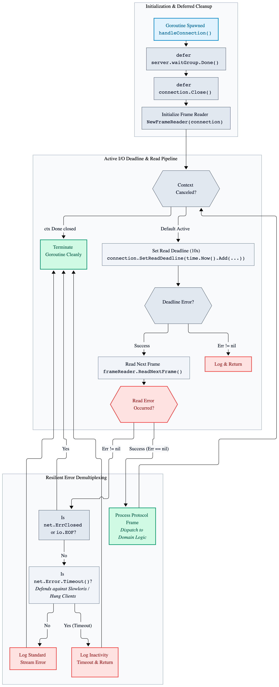
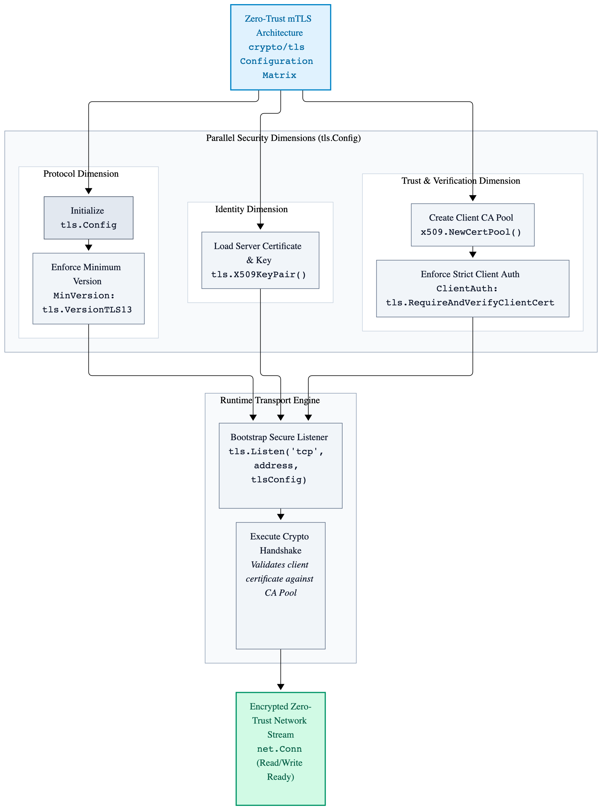
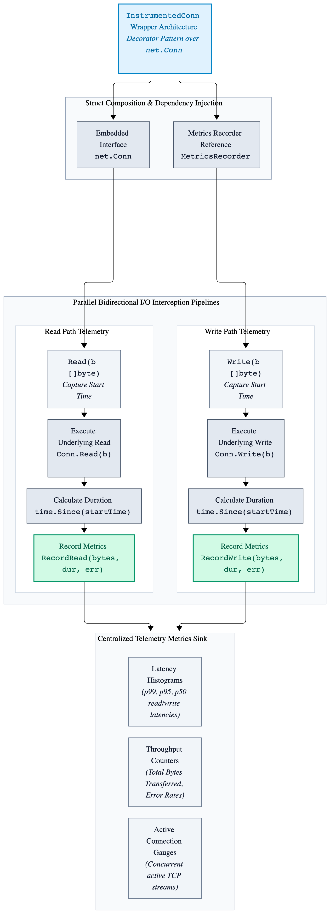

# Chapter 7 Advanced Networking Programming: TCP Listeners and Socket Tuning

While Go's net package provides a clean, idiomatic interface for socket programming, high-throughput network engineering requires explicit control over transport-layer behaviors. Production services must tune socket descriptors for low latency, manage TCP keep-alives, disable Nagle's algorithm where message cadence demands immediate delivery, and coordinate graceful listener shutdowns.

## 7.1 Configuring Socket Options for Low Latency

By default, TCP stacks use Nagle's algorithm (TCP_NODELAY disabled) to combine small outgoing packets into larger segments, reducing packet overhead at the cost of latency. For real-time binary protocols and low-latency RPC frameworks, infrastructure engineers explicitly disable Nagle's algorithm and configure keep-alives.

```go
package main

import (
	"fmt"
	"net"
	"time"
)

// ConfigureConnection applies production-grade socket options to optimize throughput and latency.
func ConfigureConnection(connection net.Conn) error {
	tcpConnection, ok := connection.(*net.TCPConn)

	if !ok {
		return fmt.Errorf("underlying connection is not a TCP connection")
	}

	// Disable Nagle's algorithm to send small binary frames immediately without buffering delays.
	if err := tcpConnection.SetNoDelay(true); err != nil {
		return fmt.Errorf("failed to set TCP_NODELAY: %w", err)
	}

	// Enable TCP keep-alive probes to detect dead client connections proactively.
	if err := tcpConnection.SetKeepAlive(true); err != nil {
		return fmt.Errorf("failed to enable TCP keep-alive: %w", err)
	}

	if err := tcpConnection.SetKeepAlivePeriod(30 * time.Second); err != nil {
		return fmt.Errorf("failed to set keep-alive period: %w", err)
	}

	// Set read and write buffer sizes to match high-throughput workload requirements.
	if err := tcpConnection.SetReadBuffer(65536); err != nil {
		return fmt.Errorf("failed to set socket read buffer: %w", err)
	}

	if err := tcpConnection.SetWriteBuffer(65536); err != nil {
		return fmt.Errorf("failed to set socket write buffer: %w", err)
	}

	return nil
}
```
---

<p align="center">
  <picture>
    <source media="(prefers-color-scheme: dark)" srcset="images/tcp-socket-tuning-and-connection-lifecycle-architecture-dark.png">
    
  </picture>
</p>

---

## 7.2 Concurrent TCP Server Architecture

Handling thousands of concurrent connections requires an asynchronous accept loop coupled with dedicated per-connection goroutines or worker pools. The following implementation demonstrates a production TCP listener skeleton with connection tuning and resource cleanup.

```go
package main

import (
	"context"
	"errors"
	"fmt"
	"io"
	"log"
	"net"
	"sync"
)

// TCPServer manages incoming network connections and coordinates graceful shutdowns.
type TCPServer struct {
	listener net.Listener
	waitGroup       sync.WaitGroup
}

// NewTCPServer initializes a TCP listener on the specified network address.
func NewTCPServer(address string) (*TCPServer, error) {
	listener, err := net.Listen("tcp", address)

	if err != nil {
		return nil, fmt.Errorf("failed to bind TCP listener on %s: %w", address, err)
	}

	return &TCPServer{
		listener: listener,
	}, nil
}

// Start begins accepting incoming client connections in the background.
func (server *TCPServer) Start(context context.Context) {
	for {
		connection, err := server.listener.Accept()

		if err != nil {
			select {
			case <-context.Done():
				// Server is shutting down normally; exit accept loop.
				return
			default:
				log.Printf("failed to accept incoming connection: %v", err)
				continue
			}
		}

		// Apply socket tuning options immediately upon acceptance.
		if err := ConfigureConnection(connection); err != nil {
			log.Printf("failed to configure socket options: %v", err)

			connection.Close()
			continue
		}

		server.waitGroup.Add(1)
		go server.handleConnection(context, connection)
	}
}

// handleConnection processes client read/write lifecycles within an isolated goroutine.
func (server *TCPServer) handleConnection(context context.Context, connection net.Conn) {
	defer server.waitGroup.Done()
	defer connection.Close()

	// Initialize the buffered frame reader for binary protocol demultiplexing.
	frameReader := NewFrameReader(connection)

	for {
		select {
		case <-context.Done():
			return
		default:
			frame, err := frameReader.ReadNextFrame()

			if err != nil {
				if errors.Is(err, net.ErrClosed) || errors.Is(err, io.EOF) {
					return
				}

				log.Printf("stream read error: %v", err)
				return
			}

			// Process incoming structured protocol frame.
			_ = frame
		}
	}
}

// Close gracefully stops the server and waits for active connections to finish.
func (server *TCPServer) Close() error {
	if err := server.listener.Close(); err != nil {
		return fmt.Errorf("failed to close listener: %w", err)
	}

	server.waitGroup.Wait()

	return nil
}
```
---

<p align="center">
  <picture>
    <source media="(prefers-color-scheme: dark)" srcset="images/concurrent-tcp-server-architecture-dark.png">
    
  </picture>
</p>

---

## 7.3 Enforcing Active I/O Deadlines

Relying solely on TCP keep-alives is insufficient for detecting hung clients, stalled writes, or slowloris-style denial-of-service vectors. Production servers must enforce strict read and write deadlines inside the connection handling loop to prevent goroutine leaks.

```go
// handleConnection processes client read/write lifecycles within an isolated goroutine with enforced deadlines.
func (server *TCPServer) handleConnection(context context.Context, connection net.Conn) {
	defer server.waitGroup.Done()
	defer connection.Close()

	frameReader := NewFrameReader(connection)

	for {
		select {
		case <-context.Done():
			return
		default:
			// Enforce a strict read deadline for the incoming frame header and payload.
			if err := connection.SetReadDeadline(time.Now().Add(10 * time.Second)); err != nil {
				log.Printf("failed to set read deadline: %v", err)
				return
			}

			frame, err := frameReader.ReadNextFrame()

			if err != nil {
				if errors.Is(err, net.ErrClosed) || errors.Is(err, io.EOF) {
					return
				}

				if networkError, ok := err.(net.Error); ok && networkError.Timeout() {
					log.Printf("client connection timed out due to inactivity")
					return
				}

				log.Printf("stream read error: %v", err)
				return
			}

			// Process incoming structured protocol frame.
			_ = frame
		}
	}
}
```
---

<p align="center">
  <picture>
    <source media="(prefers-color-scheme: dark)" srcset="images/enforcing-active-io-deadlines-dark.png">
    
  </picture>
</p>

---

## 7.4 Advanced Listener Control Via `net.ListenConfig`

Standard `net.Listen` hides low-level socket configuration hooks. For zero-downtime rolling deployments and high-performance kernel tuning (such as setting `SO_REUSEADDR`, `SO_REUSEPORT`, or adjusting listener backlog queues beyond `SOMAXCONN`), infrastructure engineers use net.ListenConfig with a custom Control callback.

```go
// CreateListenerWithControl initializes a listener with custom kernel socket control hooks.
func CreateListenerWithControl(context context.Context, address string) (net.Listener, error) {
	listenConfig := net.ListenConfig{
		Control: func(network, address string, rawConn syscall.RawConn) error {
			var sysCallError error

			err := rawConn.Control(func(fileDescriptor uintptr) {
				// Example: Set socket reuse options or adjust backlog parameters at the syscall level.
				// unix.SetsockoptInt(int(fileDescriptor), unix.SOL_SOCKET, unix.SO_REUSEPORT, 1)
			})

			if err != nil {
				return err
			}

			return sysCallError
		},
	}

	return listenConfig.Listen(context, "tcp", address)
}
```
## 7.5 Securing the Transport Layer with Mutal TLS (mTLS)

Production network services rarely expose raw unencrypted TCP streams. Integrating Transport Layer Security (TLS) via Go's `crypto/tls` package—while enforcing strict cipher suites, minimum TLS versions, and mutual client certificate authentication (`RequireAndVerifyClientCert`) is critical for zero-trust infrastructure.

- **Key Concepts to Cover:** Configuring `tls.Config`, `setting MinVersion`: `tls.VersionTLS13`, managing custom certificate pools, and wrapping raw connections or using tls.Listen.

---

<p align="center">
  <picture>
    <source media="(prefers-color-scheme: dark)" srcset="images/securing-transport-layer-with-mtls-dark.png">
    
  </picture>
</p>

---

## 7.6 Instrumented Telemetry Wrappers (`InstrumentConn`)

To monitor production network health without cluttering core connection handlers, systems engineers use decorator/wrapper patterns around `net.Conn`. By implementing a custom `InstrumentedConn` struct that wraps net.Conn, you can transparently record Prometheus metrics for active connection gauges, total bytes transferred, and read/write latencies.

```go
// InstrumentedConn wraps net.Conn to transparently capture transport-layer metrics.
type InstrumentedConn struct {
	net.Conn
	metricsRecorder MetricsRecorder
}

// Read wraps the underlying connection read operation to record performance telemetry.
func (instrumentedConnection *InstrumentedConn) Read(destinationBuffer []byte) (bytesRead int, readError error) {
	startTime := time.Now()

	bytesRead, readError = instrumentedConnection.Conn.Read(destinationBuffer)
	instrumentedConnection.metricsRecorder.RecordRead(bytesRead, time.Since(startTime), readError)

	return bytesRead, readError
}
```
---

<p align="center">
  <picture>
    <source media="(prefers-color-scheme: dark)" srcset="images/advanced-instrumented-telemetry-wrappers-dark.png">
    
  </picture>
</p>

---

## 7.7 Optimizing Handshakes with TCP Fast Open (TFO)

For high-frequency RPC clients and low-latency microservices, the standard 3-way TCP handshake adds an unavoidable round-trip time (RTT) penalty before data transmission begins. Enabling TCP Fast Open allows data to be sent in the SYN packet.


