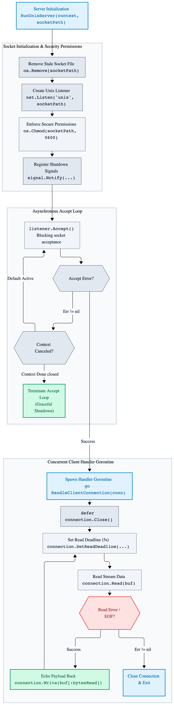
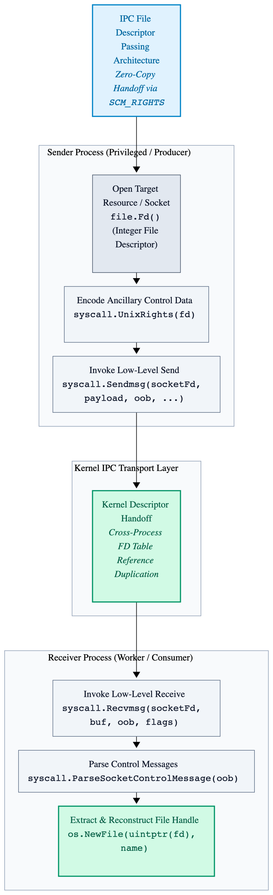
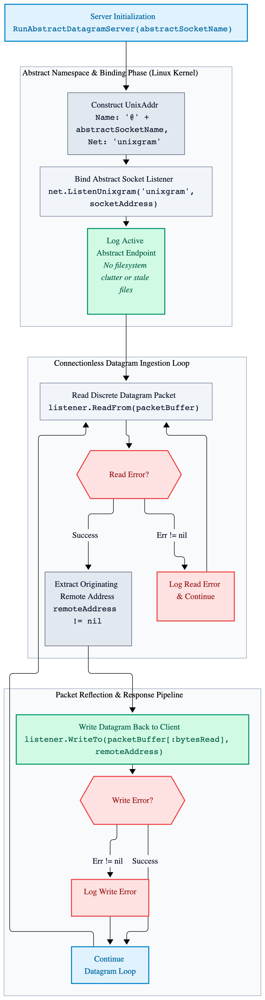
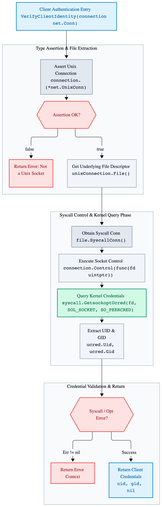
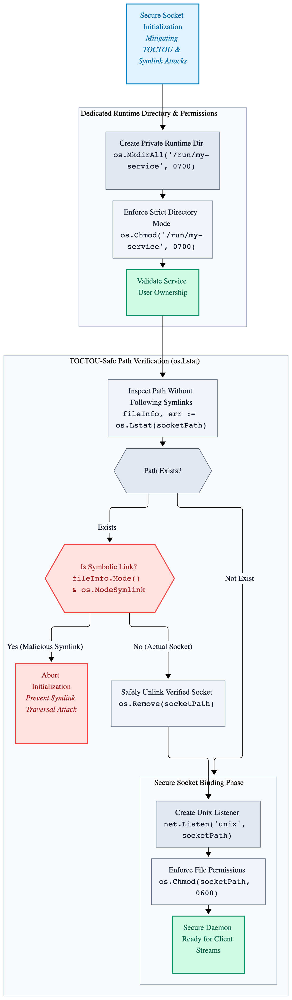

# Chapter 8: Low-Level IPC & Unix Domain Sockets (macOS/Linux)

Inter-process communication (IPC) on Unix-like operating systems provides high-performance, low-latency communication channels that bypass the network stack entirely. While TCP loopback communication (127.0.0.1) incurs overhead from IP routing, packet header processing, and firewall rule evaluation, Unix domain sockets (AF_UNIX) operate directly within the kernel using local file system paths or abstract namespaces.

This chapter explores production-grade IPC patterns in Go, focusing on secure listener initialization, stream multiplexing, and advanced control-message manipulation for file descriptor passing (SCM_RIGHTS), a core capability exclusive to POSIX-compliant environments like macOS and Linux.

## 8.1 Unix Domain Socket Server & Client Implementation

Unix domain sockets present a standard stream-oriented interface via `net.Conn` and `net.Listener`, allowing developers to reuse existing network abstractions. However, unlike TCP ports, Unix sockets persist as files on the local file system and require explicit cleanup and permission enforcement.

The following production-grade implementation demonstrates a secure Unix domain socket server that cleans up stale socket files, restricts file permissions, and handles concurrent client streams.

```go
package main

import (
	"context"
	"fmt"
	"log"
	"net"
	"os"
	"os/signal"
	"syscall"
	"time"
)

// RunUnixServer initializes a Unix domain socket server at the specified file path.
func RunUnixServer(context context.Context, socketPath string) error {
	// Remove any stale socket file left behind from previous application executions.
	if removeError := os.Remove(socketPath); removeError != nil && !os.IsNotExist(removeError) {
		return fmt.Errorf("failed to remove existing socket file: %w", removeError)
	}

	// Create a new Unix domain socket listener on the local file system path.
	listener, creationError := net.Listen("unix", socketPath)

	if creationError != nil {
		return fmt.Errorf("failed to listen on unix socket: %w", creationError)
	}

	defer listener.Close()

	// Enforce strict file system permissions on the socket file to prevent unauthorized access.
	if chmodError := os.Chmod(socketPath, 0600); chmodError != nil {
		return fmt.Errorf("failed to set socket file permissions: %w", chmodError)
	}

	// Create a buffered channel to capture operating system shutdown signals.
	shutdownChannel := make(chan os.Signal, 1)

	signal.Notify(shutdownChannel, os.Interrupt, syscall.SIGTERM)

	go func() {
		<-shutdownChannel
		listener.Close()
	}()

	for {
		// Accept incoming connection requests from authorized local client processes.
		connection, acceptanceError := listener.Accept()

		if acceptanceError != nil {
			select {
			case <-context.Done():
				return nil
			default:
				log.Printf("error accepting incoming connection: %v\n", acceptanceError)
				continue
			}
		}

		// Handle each client connection concurrently in a dedicated worker goroutine.
		go HandleClientConnection(connection)
	}
}

// HandleClientConnection reads incoming data streams from a client connection and echoes them back.
func HandleClientConnection(connection net.Conn) {
	defer connection.Close()

	// Allocate a destination byte buffer for incoming stream data.
	destinationBuffer := make([]byte, 1024)

	for {
		// Set an active read deadline to prevent hanging goroutines and slowloris vectors.
		connection.SetReadDeadline(time.Now().Add(5 * time.Second))

		bytesRead, readError := connection.Read(destinationBuffer)

		if readError != nil {
			break
		}

		// Echo the received payload bytes directly back to the client process.
		_, writeError := connection.Write(destinationBuffer[:bytesRead])

		if writeError != nil {
			break
		}
	}
}
```
---

<p align="center">
  <picture>
    <source media="(prefers-color-scheme: dark)" srcset="images/unix-socket-server-architecture-dark.png">
    
  </picture>
</p>

---

## 8.2 Advanced Ancillary Data & File Descriptor Passing (`SCM_RIGHS`)

The most powerful feature of Unix domain sockets on macOS and Linux is the ability to transmit raw operating system file descriptors between completely independent processes. This mechanism enables zero-copy handoffs, privilege separation (where an unprivileged worker receives an already-bound privileged socket), and dynamic resource sharing.

Transmitting file descriptors requires sending ancillary control data (out-of-band data) alongside socket payloads using low-level syscall.Sendmsg and syscall.Recvmsg functions.

---

<p align="center">
  <picture>
    <source media="(prefers-color-scheme: dark)" srcset="images/unix-domain-socket-file-descriptor-passing-sequence-diagram-dark.png">
    
  </picture>
</p>

---

```go
package main

import (
	"fmt"
	"net"
	"os"
	"syscall"
)

// SendFileDescriptor transmits an open file descriptor across an active Unix domain socket connection using ancillary data.
func SendFileDescriptor(connection *net.UnixConn, fileToSend *os.File, payload []byte) error {
	rawFileDescriptor := int(fileToSend.Fd())
	ancillaryData := syscall.UnixRights(rawFileDescriptor)

	fileConnection, fileError := connection.File()

	if fileError != nil {
		return fmt.Errorf("failed to obtain underlying file descriptor: %w", fileError)
	}

	defer fileConnection.Close()

	socketFileDescriptor := int(fileConnection.Fd())

	// Transmit the payload and the ancillary file descriptor via syscall.Sendmsg.
	sentBytes, sendError := syscall.Sendmsg(socketFileDescriptor, payload, ancillaryData, nil, 0)

	if sendError != nil {
		return fmt.Errorf("failed to send message with ancillary data: %w", sendError)
	}

	if sentBytes != len(payload) {
		return fmt.Errorf("short write: sent %d of %d bytes", sentBytes, len(payload))
	}

	return nil
}

// ReceiveFileDescriptor receives a payload and an ancillary file descriptor from a Unix domain socket connection.
func ReceiveFileDescriptor(connection *net.UnixConn) (*os.File, []byte, error) {
	fileConnection, fileError := connection.File()

	if fileError != nil {
		return nil, nil, fmt.Errorf("failed to obtain underlying file descriptor: %w", fileError)
	}

	defer fileConnection.Close()

	socketFileDescriptor := int(fileConnection.Fd())

	payloadBuffer := make([]byte, 256)
	ancillaryBuffer := make([]byte, syscall.Cspace(4))

	_, _, _, _, receiveError := syscall.Recvmsg(socketFileDescriptor, payloadBuffer, ancillaryBuffer, 0)

	if receiveError != nil {
		return nil, nil, fmt.Errorf("failed to receive message with ancillary data: %w", receiveError)
	}

	controlMessages, parseError := syscall.ParseSocketControlMessage(ancillaryBuffer)

	if parseError != nil {
		return nil, nil, fmt.Errorf("failed to parse socket control message: %w", parseError)
	}

	for _, controlMessage := range controlMessages {
		if controlMessage.Header.Level == syscall.SOL_SOCKET && controlMessage.Header.Type == syscall.SCM_RIGHTS {
			extractedFileDescriptors, rightsError := syscall.ParseUnixRights(&controlMessage)

			if rightsError != nil {
				return nil, nil, fmt.Errorf("failed to parse unix rights: %w", rightsError)
			}

			if len(extractedFileDescriptors) > 0 {
				sharedFile := os.NewFile(uintptr(extractedFileDescriptors[0]), "shared-resource")
				return sharedFile, payloadBuffer, nil
			}
		}
	}

	return nil, nil, fmt.Errorf("no file descriptor received in ancillary data")
}
```
---

## 8.3 Linux Abstract Namespaces & Datagram UNIX Sockets (`SOCK_DGRAM`)

Beyond standard file-system paths and stream-oriented connections (`SOCK_STREAM`), Linux Unix domain sockets support two advanced paradigms critical for high-performance daemon architectures and container isolation: **Abstract Namespaces** and **Datagram Sockets (`SOCK_DGRAM`)**.

### Linux Abstract Sockets

On Linux, prefixing a Unix socket path with a null byte (\0 or \x00) places the socket into the abstract namespace rather than the standard file system. Abstract sockets do not leave stale files on disk when a process crashes, require no file system permission checks (relying instead on peer credential inspection via SO_PEERCRED), and simplify containerized deployments where volume mounts are restricted.

### Datagram UNIX Sockets

While stream sockets (`SOCK_STREAM`) mimic TCP by providing reliable, ordered byte streams, datagram sockets (`SOCK_DGRAM`) mimic UDP over local IPC. They preserve message boundaries without framing overhead, making them ideal for high-throughput, record-oriented logging daemons and telemetry pipelines.

### Production Implementation: Abstract Namespace Datagram Listener

```go
package main

import (
	"fmt"
	"log"
	"net"
	"os"
	"os/signal"
	"syscall"
)

// RunAbstractDatagramServer initializes a connectionless Unix datagram listener in the Linux abstract namespace.
func RunAbstractDatagramServer(abstractSocketName string) error {
	// Construct the abstract namespace address by prepending a null byte to the socket name.
	// Note: This feature is specific to Linux kernels and is unsupported on macOS/BSD.
	socketAddress := &net.UnixAddr{
		Name: "@" + abstractSocketName,
		Net:  "unixgram",
	}

	// Listen for incoming datagram packets on the abstract socket address.
	listener, creationError := net.ListenUnixgram("unixgram", socketAddress)

	if creationError != nil {
		return fmt.Errorf("failed to bind abstract datagram socket: %w", creationError)
	}

	defer listener.Close()

	log.Printf("abstract datagram server active on @%s\n", abstractSocketName)

	packetBuffer := make([]byte, 1024)

	for {
		// Read discrete message packets without stream fragmentation or framing overhead.
		bytesRead, remoteAddress, readError := listener.ReadFrom(packetBuffer)

		if readError != nil {
			log.Printf("error reading datagram packet: %v\n", readError)
			continue
		}

		// Process or echo the discrete message payload back to the originating client.
		if remoteAddress != nil {
			_, writeError := listener.WriteTo(packetBuffer[:bytesRead], remoteAddress)

			if writeError != nil {
				log.Printf("error writing response datagram: %v\n", writeError)
			}
		}
	}
}
```
---

<p align="center">
  <picture>
    <source media="(prefers-color-scheme: dark)" srcset="images/linux-abstract-namespace-datagram-socket-flow-dark.png">
    
  </picture>
</p>

---

| IPC Mechanism | Socket Type | Namespace | Key Use Case | Platform Support |
| :--- | :--- | :--- | :--- | :--- |
| **Standard Stream** | `SOCK_STREAM` | File System | General local client-server IPC, HTTP-over-Unix | POSIX (macOS, Linux, BSD) |
| **File Descriptor Handoff** | `SOCK_STREAM` + `SCM_RIGHTS` | File System | Zero-downtime socket activation, privilege separation | POSIX (macOS, Linux, BSD) |
| **Abstract Datagram** | `SOCK_DGRAM` | Abstract (`\0`) | Container telemetry, high-frequency logging daemons | Linux Only |
---

## 8.4  Local Client Authentication via Peer Credentials (`SO_PEERCRED` / `LOCAL_PEERCRED`)

Unix domain socket permissions (chmod 0600) only restrict file system access at connection time, a malicious local user with read/write access to the socket file can connect to your server. To implement fine-grained authorization (e.g., verifying that the connecting client runs as a specific UID or PID), servers must inspect peer credentials kernel-side immediately after accepting a connection.

- **Linux:** Uses `SO_PEERCRED` via `syscall.GetsocketUcred`.
- **Mac OS / BSD:** Uses `LOCAL_PEERCED`via `syscall.getpeername or socket options.

### Production Implemnetation: Inspecting Linux Peer Credentials

```go
package main

import (
	"fmt"
	"net"
	"syscall"
)

// VerifyClientIdentity extracts the PID, UID, and GID of the connected local client process.
func VerifyClientIdentity(connection net.Conn) (int, int, error) {
	unixConnection, ok := connection.(*net.UnixConn)

	if !ok {
		return 0, 0, fmt.Errorf("connection is not a unix socket")
	}

	file, err := unixConnection.File()

	if err != nil {
		return 0, 0, fmt.Errorf("failed to get underlying file: %w", err)
	}

	defer file.Close()

	// Retrieve the Ucred structure from the kernel socket layer.
	// Note: syscall.SOL_SOCKET and syscall.SO_PEERCRED are Linux-specific.
	connection, err = file.SyscallConn()

	if err != nil {
		return 0, 0, fmt.Errorf("failed to get syscall conn: %w", err)
	}

	var uid, gid int
	var sysError error

	err = connection.Control(func(fd uintptr) {
		ucred, cerr := syscall.GetsockoptUcred(int(fd), syscall.SOL_SOCKET, syscall.SO_PEERCRED)

		if cerr != nil {
			sysError = cerr
			return
		}

		uid = int(ucred.Uid)
		gid = int(ucred.Gid)
	})

	if err != nil {
		return 0, 0, err
	}

	if sysError != nil {
		return 0, 0, fmt.Errorf("getsockopt failed: %w", sysErr)
	}

	return uid, gid, nil
}
```

---

<p align="center">
  <picture>
    <source media="(prefers-color-scheme: dark)" srcset="images/unix-socket-peer-credential-authentication-sequence-dark.png">
    
  </picture>
</p>

---

## 8.5 Zero-Downtime Restarts via Systems Socket Activation

File descriptor passing (Section 8.2) enables **Socket Activation**, where an external process init system (such as systemd on Linux) binds the Unix socket prior to application startup. When your Go daemon restarts or upgrades, it inherits the pre-bound listener file descriptor (typically FD 3 under `systemd`), allowing zero packet loss during binary deployments.

### Inheriting Pre-Bound Listeners in Go

```go
package main

import (
	"fmt"
	"net"
	"os"
)

// InitSystemdListener recovers a pre-bound Unix listener passed by systemd (FD 3).
func InitSystemdListener() (net.Listener, error) {
	// Systemd passes listeners starting at file descriptor index 3.
	// LISTEN_FDS environment variable specifies how many FDs were passed.
	if os.Getenv("LISTEN_FDS") == "" {
		return nil, fmt.Errorf("no systemd socket activation FDs found")
	}

	file := os.NewFile(3, "systemd-socket")

	defer file.Close()

	listener, err := net.FileListener(file)

	if err != nil {
		return nil, fmt.Errorf("failed to create listener from inherited file descriptor: %w", err)
	}

	return listener, nil
}
```

## 8.6 Security Hardening & Mitigating TOCTOU Vulnerabilities

Placing Unix socket files in shared directories like /tmp or /var/run without strict path controls introduces major security risks:

1. **TOCTOU (Time-of-Check to Time-of-Use) Race Conditions:** If an unprivileged user creates a symbolic link or pre-creates a malicious socket file at your target path before your root/privileged daemon starts, your server might write to or unlink unintended paths.
2. **Directory Permissions:** Changing permissions on the socket file (chmod 0600) is insufficient if the parent directory is world-writable (/tmp), allowing other local users to hijack the path or perform denial-of-service attacks by locking the file node.

### Best Practiccs for Secure Path Initialization.
- **Dedicated Runtime Directories:** Always create private runtime directory with strict permissions before binding the socket (e.g., /run.my-service/ owned by the service user with 0700 permissions).
- **Atomic Cleanup Verification:** Check file modes via `os.Lstat` rather than `os.Stat` to ensure you are unlinking an actual socket file and not following an untrusted symlink.

---

<p align="center">
  <picture>
    <source media="(prefers-color-scheme: dark)" srcset="images/unix-socket-toctou-security-hardening-flow-dark.png">
    
  </picture>
</p>

---
