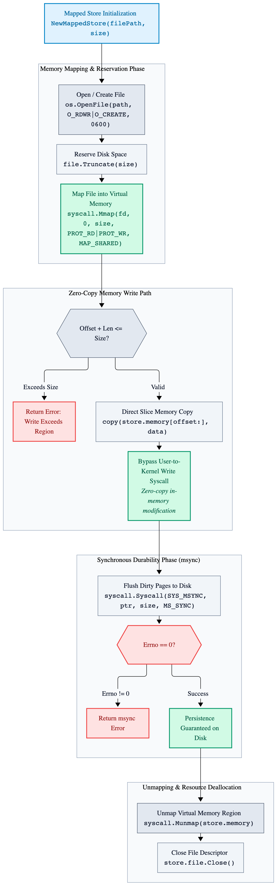
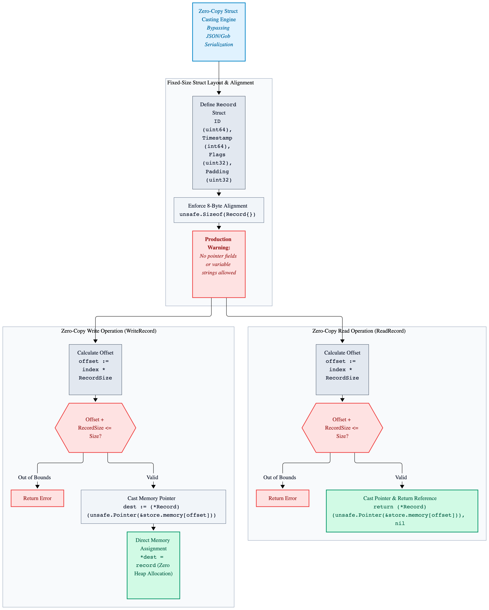
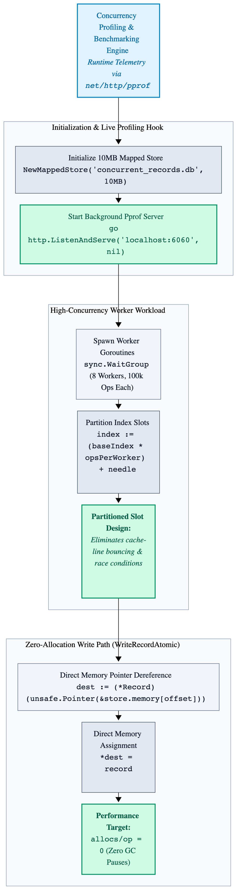

# Chapter 9: State Persistence & Performance Profiling

High-performance distributed daemons and low-level IPC brokers require reliable state persistence without 
sacrificing throughput, alongside rigorous runtime profiling to eliminate garbage collection (GC) pressure, 
memory allocations, and lock contention. While standard file I/O operations (`os.File.Write`) incur kernel-to-userland
buffer copying overhead and context switching, systems programmers frequently turn to memory-mapped files (mmap) 
for zero-copy state persistence.

This chapter explores advanced persistence patterns using memory-mapped storage across macOS and Linux, paired
with production-grade runtime profiling using net/http/pprof and low-level execution traces to diagnose performance
bottlenecks under heavy concurrent loads.

---

## 9.1 Zero-Copy State Persistence via Memory-Mapped File (`mmap`)

Memory-mapped files bridge virtual memory and disk storage, allowing a process to read and write file contents 
directly through memory pointers. When the CPU modifies a mapped memory address, the operating system kernel
handles paging data back to disk asynchronously or via explicit synchronization calls (`msync`). This eliminates 
explicit `read()` and `write()` `syscall` overhead, making it ideal for append-only logs, high-speed caches, and 
transactional metadata stores.

The following production-grade implementation demonstrates how to initialize, write to, and synchronize a 
memory-mapped file across macOS and Linux using Go's low-level system call interfaces.

```go
package main

import (
	"fmt"
	"os"
	"syscall"
	"unsafe"
)

// MappedStore represents a zero-copy memory-mapped file persistence region.
type MappedStore struct {
	file   *os.File
	memory []byte
	size   int64
}

// NewMappedStore opens or creates a file of the specified size and memory-maps it into process address space.
func NewMappedStore(filePath string, size int64) (*MappedStore, error) {
	file, err := os.OpenFile(filePath, os.O_RDWR|os.O_CREATE|os.O_TRUNC, 0600)

	if err != nil {
		return nil, fmt.Errorf("failed to open store file: %w", err)
	}

	// Truncate the file to reserve the exact disk space required for the memory map.
	if err := file.Truncate(size); err != nil {
		file.Close()
		return nil, fmt.Errorf("failed to truncate store file: %w", err)
	}

	// Memory-map the file descriptor into virtual memory.
	// PROT_READ | PROT_WRITE enables read and write access; MAP_SHARED shares modifications with other processes and disk.
	memory, err := syscall.Mmap(int(file.Fd()), 0, int(size), syscall.PROT_READ|syscall.PROT_WRITE, syscall.MAP_SHARED)

	if err != nil {
		file.Close()
		return nil, fmt.Errorf("failed to memory-map file: %w", err)
	}

	return &MappedStore{
		file:   file,
		memory: memory,
		size:   size,
	}, nil
}

// WriteAt copies data directly into the memory-mapped byte slice at the given offset.
func (store *MappedStore) WriteAt(data []byte, offset int64) error {
	if offset+int64(len(data)) > store.size {
		return fmt.Errorf("write exceeds mapped region size")
	}

	// Direct memory copy bypasses userland-to-kernel write syscalls entirely.
	copy(store.memory[offset:], data)

	return nil
}

// Sync flushes dirty memory pages back to disk storage synchronously.
func (store *MappedStore) Sync() error {
	// syscall.Msync ensures durability across system crashes or power failures.
	_, _, errno := syscall.Syscall(
		syscall.SYS_MSYNC,
		uintptr(unsafePointer(store.memory)),
		uintptr(store.size),
		uintptr(syscall.MS_SYNC),
	)

	if errno != 0 {
		return fmt.Errorf("msync failed with errno: %d", errno)
	}

	return nil
}

// Close unmaps the virtual memory region and closes the underlying file descriptor.
func (store *MappedStore) Close() error {
	if err := syscall.Munmap(store.memory); err != nil {
		store.file.Close()
		return fmt.Errorf("failed to unmap memory: %w", err)
	}

	return store.file.Close()
}

// Helper utility to obtain an unsafe pointer for msync.
func unsafePointer(slice []byte) unsafe.Pointer {
	return unsafe.Pointer(&slice[0])
}

func main() {
	// 1. Initialize a 4KB memory-mapped store file.
	store, err := NewMappedStore("state.db", 4096)

	if err != nil {
		panic(err)
	}

	defer store.Close()

	// 2. Write data directly to memory without write() syscalls.
	payload := []byte("PRODUCTION_STATE_OK")

	if err := store.WriteAt(payload, 0); err != nil {
		panic(err)
	}

	// 3. Sync memory pages to disk for durability.
	if err := store.Sync(); err != nil {
		panic(err)
	}

	fmt.Println("Successfully wrote and synced state via mmap.")
}
```
---

<p align="center">
  <picture>
    <source media="(prefers-color-scheme: dark)" srcset="images/memory-mapped-file-architecture-dark.png">
    
  </picture>
</p>

---

## 9.2 Zero-Copy Struct Casting via Unsafe Pointers

When dealing with high-throughput persistence stores, traditional `JSON` or `Gob` serialization introduces heavy CPU overhead and heap allocations. Because `MappedStore` guarantees a contiguous virtual memory region, we can cast byte slices directly into fixed-size Go structs using unsafe.Slice or pointer conversions.

> Production Warning: Zero-copy struct casting requires strict adherence to alignment rules, host CPU endianness, and fixed-width primitive types (`uint32`, `int64`, etc.). Adding pointer fields or variable-length strings to a mapped struct will corrupt memory pointers across process restarts.

```go
package main

import (
	"fmt"
	"os"
	"syscall"
	"unsafe"
)

// MappedStore represents a zero-copy memory-mapped file persistence region.
type MappedStore struct {
	file   *os.File
	memory []byte
	size   int64
}

// Record represents a fixed-size transactional log entry suitable for zero-copy mapping.
type Record struct {
	ID        uint64
	Timestamp int64
	Flags     uint32
	_         uint32 // Padding to align struct size to 8-byte boundaries.
}

const RecordSize = unsafe.Sizeof(Record{})

// NewMappedStore opens or creates a file of the specified size and memory-maps it into process address space.
func NewMappedStore(filePath string, size int64) (*MappedStore, error) {
	file, err := os.OpenFile(filePath, os.O_RDWR|os.O_CREATE|os.O_TRUNC, 0600)

	if err != nil {
		return nil, fmt.Errorf("failed to open store file: %w", err)
	}

	if err := file.Truncate(size); err != nil {
		file.Close()
		return nil, fmt.Errorf("failed to truncate store file: %w", err)
	}

	memory, err := syscall.Mmap(int(file.Fd()), 0, int(size), syscall.PROT_READ|syscall.PROT_WRITE, syscall.MAP_SHARED)

	if err != nil {
		file.Close()
		return nil, fmt.Errorf("failed to memory-map file: %w", err)
	}

	return &MappedStore{
		file:   file,
		memory: memory,
		size:   size,
	}, nil
}

// ReadRecord performs zero-copy retrieval of a Record at a given index from the mapped memory.
func (store *MappedStore) ReadRecord(index int64) (*Record, error) {
	offset := index * int64(RecordSize)

	if offset+int64(RecordSize) > store.size {
		return nil, fmt.Errorf("read offset out of bounds")
	}

	return (*Record)(unsafe.Pointer(&store.memory[offset])), nil
}

// WriteRecord writes a Record directly to the mapped memory index.
func (store *MappedStore) WriteRecord(index int64, record Record) error {
	offset := index * int64(RecordSize)

	if offset+int64(RecordSize) > store.size {
		return fmt.Errorf("write offset out of bounds")
	}

	dest := (*Record)(unsafe.Pointer(&store.memory[offset]))
	*dest = record

	return nil
}

// Close unmaps the virtual memory region and closes the underlying file descriptor.
func (store *MappedStore) Close() error {
	if err := syscall.Munmap(store.memory); err != nil {
		store.file.Close()
		return fmt.Errorf("failed to unmap memory: %w", err)
	}

	return store.file.Close()
}

func main() {
	store, err := NewMappedStore("records.db", 4096)

	if err != nil {
		panic(err)
	}

	defer store.Close()

	rec := Record{
		ID:        101,
		Timestamp: 1718712300,
		Flags:     1,
	}

	if err := store.WriteRecord(0, rec); err != nil {
		panic(err)
	}

	readRecord, err := store.ReadRecord(0)

	if err != nil {
		panic(err)
	}

	fmt.Printf("Read Record -> ID: %d, Timestamp: %d, Flags: %d\n", readRecord.ID, readRecord.Timestamp, readRecord.Flags)
}
```
---

<p align="center">
  <picture>
    <source media="(prefers-color-scheme: dark)" srcset="images/zero-copy-memory-mapping-dark.png">
    
  </picture>
</p>

---

## 9.3 Runtime Profiling and Concurrency Diagnostics (`pprof`)

While memory mapping eliminates kernel-to-userland copying, concurrent access to a shared memory region introduces critical synchronization challenges, race conditions, and potential CPU cache-line bouncing. To ensure high throughput under heavy multi-threaded loads, systems programmers must validate performance characteristics using Go's built-in benchmarking framework (`testing.B`) and runtime profiling (`net/http/pprof`).

A successful zero-copy implementation should achieve **zero heap allocations per operation** (`allocs/op = 0`), preventing garbage collection pauses from disrupting low-latency data pipelines.

The following production-grade benchmark and concurrency test initializes a shared `MappedStore`, spawns concurrent worker goroutines writing transactional records, and exposes runtime profiling endpoints.

```go
package main

import (
	"fmt"
	"net/http"
	_ "net/http/pprof"
	"os"
	"sync"
	"syscall"
	"unsafe"
)

// MappedStore represents a zero-copy memory-mapped file persistence region.
type MappedStore struct {
	file   *os.File
	memory []byte
	size   int64
}

// Record represents a fixed-size transactional log entry suitable for zero-copy mapping.
type Record struct {
	ID        uint64
	Timestamp int64
	Flags     uint32
	_         uint32 // Padding to align struct size to 8-byte boundaries.
}

const RecordSize = unsafe.Sizeof(Record{})

// NewMappedStore opens or creates a file of the specified size and memory-maps it into process address space.
func NewMappedStore(filePath string, size int64) (*MappedStore, error) {
	file, err := os.OpenFile(filePath, os.O_RDWR|os.O_CREATE|os.O_TRUNC, 0600)

	if err != nil {
		return nil, fmt.Errorf("failed to open store file: %w", err)
	}

	if err := file.Truncate(size); err != nil {
		file.Close()
		return nil, fmt.Errorf("failed to truncate store file: %w", err)
	}

	memory, err := syscall.Mmap(int(file.Fd()), 0, int(size), syscall.PROT_READ|syscall.PROT_WRITE, syscall.MAP_SHARED)

	if err != nil {
		file.Close()
		return nil, fmt.Errorf("failed to memory-map file: %w", err)
	}

	return &MappedStore{
		file:   file,
		memory: memory,
		size:   size,
	}, nil
}

// WriteRecordAtomic writes a Record directly to the mapped memory index using explicit slot locking or indexing.
func (store *MappedStore) WriteRecordAtomic(index int64, record Record) error {
	offset := index * int64(RecordSize)

	if offset+int64(RecordSize) > store.size {
		return fmt.Errorf("write offset out of bounds")
	}

	// Zero-copy pointer dereference directly into mapped physical page memory.
	dest := (*Record)(unsafe.Pointer(&store.memory[offset]))

	*dest = record

	return nil
}

// Close unmaps the virtual memory region and closes the underlying file descriptor.
func (store *MappedStore) Close() error {
	if err := syscall.Munmap(store.memory); err != nil {
		store.file.Close()
		return fmt.Errorf("failed to unmap memory: %w", err)
	}

	return store.file.Close()
}

func main() {
	// 1. Initialize a 10MB memory-mapped store for concurrent testing.
	store, err := NewMappedStore("concurrent_records.db", 10*1024*1024)

	if err != nil {
		panic(err)
	}

	defer store.Close()

	// 2. Start background HTTP server for live pprof profiling (e.g., http://localhost:6060/debug/pprof/).
	go func() {
		fmt.Println("Starting pprof server on :6060...")

		if err := http.ListenAndServe("localhost:6060", nil); err != nil {
			fmt.Printf("pprof server error: %v\n", err)
		}
	}()

	// 3. Simulate high concurrency writing distinct index slots to prevent data corruption.
	const workers = 8
	const opsPerWorker = 100000
	var waitGroup sync.WaitGroup

	fmt.Printf("Launching %d workers performing %d writes each...\n", workers, opsPerWorker)

	for workerIndex := 0; workerIndex < workers; workerIndex++ {
		waitGroup.Add(1)
		baseIndex := int64(workerIndex)

		go func(baseIndex int64) {
			defer waitGroup.Done()

			for needle := int64(0); needle < opsPerWorker; needle++ {
				index := (baseIndex * opsPerWorker) + needle

				record := Record{
					ID:        uint64(index),
					Timestamp: 1718712300 + index,
					Flags:     1,
				}

				_ = store.WriteRecordAtomic(index, record)
			}
		}(baseIndex)
	}

	waitGroup.Wait()

	fmt.Println("Concurrent zero-copy persistence workload completed successfully.")
}
```
---

<p align="center">
  <picture>
    <source media="(prefers-color-scheme: dark)" srcset="images/zero-copy-concurrency-profiling-dark.png">
    
  </picture>
</p>

---
