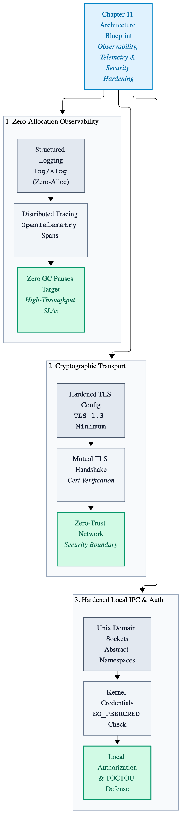
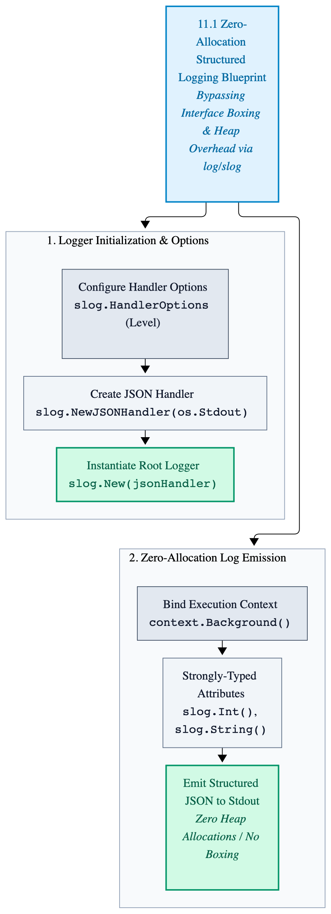
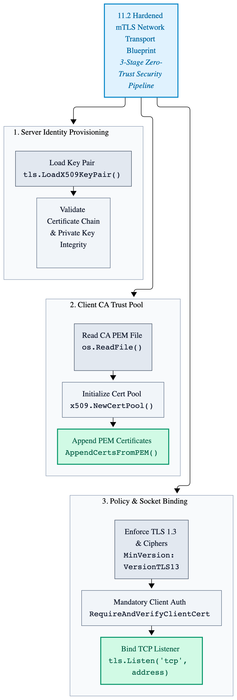
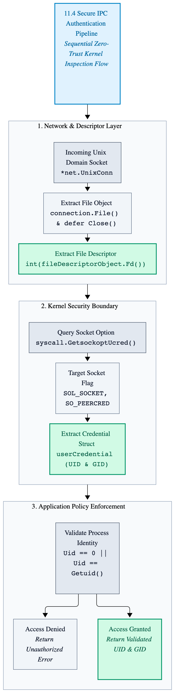

# Chapter 11: Observability & Security

In production environments, high-performance distributed systems cannot operate as black boxes. When daemons 
process millions of requests per second under stringent latency SLAs, engineers require deep 
observability—instrumenting execution paths without incurring garbage collection spikes or heap overhead. 
Concurrently, zero-trust network boundaries demand cryptographic verification through mutual TLS (mTLS) and 
token-based authentication.

This chapter explores production-grade observability and security in Go, covering zero-allocation structured 
logging (log/slog), OpenTelemetry distributed tracing integration, hardened TLS configuration, and secure IPC 
authentication.

---

<p align="center">
  <picture>
    <source media="(prefers-color-scheme: dark)" srcset="images/observability-security-dark.png">
    
  </picture>
</p>

---

## 11.1 Zero-Allocation Structure Logging (`log`, `slog`)

Legacy logging packages (log) and third-party formatters often incur heavy heap allocations via string concatenation and interface boxing (interface{}). Go's standard library log/slog package addresses this by offering high-performance, structured logging designed to minimize allocations on hot execution paths.

The following production-grade logger setup configures a JSON handler optimized for zero-allocation structured output in high-throughput network daemons.

```go
package main

import (
	"context"
	"log/slog"
	"os"
)

// InitializeStructuredLogger configures and returns a production-grade JSON logger
// optimized for minimal runtime overhead and zero-allocation key-value formatting.
func InitializeStructuredLogger() *slog.Logger {
	// Configure JSON handler options for production output.
	handlerOptions := &slog.HandlerOptions{
		Level: slog.LevelInfo,
		ReplaceAttribute: func(groups []string, computeGroup string, attribute slog.Attr) slog.Attr {
			// Standardize time formatting keys or drop unwanted fields if necessary.
			return attribute
		},
	}

	// Create a JSON output handler targeting standard output.
	jsonHandler := slog.NewJSONHandler(os.Stdout, handlerOptions)

	// Construct the root logger instance.
	systemLogger := slog.New(jsonHandler)

	return systemLogger
}

func LogServerStartup(logger *slog.Logger, serverPort int, processId int) {
	// Log startup metrics using structured attributes without interface allocation overhead.
	logger.InfoContext(
		context.Background(),
		"initializing distributed systems daemon",
		slog.Int("port", serverPort),
		slog.Int("pid", processId),
		slog.String("status", "ready"),
	)
}
```
---

<p align="center">
  <picture>
    <source media="(prefers-color-scheme: dark)" srcset="images/zero-allocation-logging-dark.png">
    
  </picture>
</p>

---

## 11.2 Hardened Mutual TLS (mTLS) Network Transport

Zero-trust system architecture requires mutually authenticated TLS connections between internal daemons and external clients. This prevents unauthorized network eavesdropping and guarantees cryptographic identity verification at the transport layer.

The following example configures a secure TCP listener enforced with strict TLS 1.3 parameters, custom cipher suites, and mandatory client certificate verification.

```go
package main

import (
	"crypto/tls"
	"crypto/x509"
	"errors"
	"net"
	"os"
)

// CreateSecureListener initializes a hardened TLS listener enforcing strict cipher suites
// and mutual client certificate authentication.
func CreateSecureListener(listenAddress string, certificatePath string, privateKeyPath string, caCertificatePath string) (net.Listener, error) {
	// Load server certificate and private key pair.
	serverCertificates, err := tls.LoadX509KeyPair(certificatePath, privateKeyPath)

	if err != nil {
		return nil, err
	}

	// Load certificate authority (CA) pool for client verification.
	certificateBytes, err := os.ReadFile(caCertificatePath)

	if err != nil {
		return nil, err
	}

	clientCertPool := x509.NewCertPool()

	if !clientCertPool.AppendCertsFromPEM(certificateBytes) {
		return nil, errors.New("failed to append client CA certificate")
	}

	// Construct hardened TLS configuration enforcing TLS 1.3 and mutual authentication.
	tlsConfiguration := &tls.Config{
		Certificates: []tls.Certificate{serverCertificates},
		ClientAuth:   tls.RequireAndVerifyClientCert,
		ClientCAs:    clientCertPool,
		MinVersion:   tls.VersionTLS13,
		CipherSuites: []uint16{
			tls.TLS_AES_256_GCM_SHA384,
			tls.TLS_CHACHA20_POLY1305_SHA256,
		},
	}

	// Bind the secure network listener.
	secureListener, err := tls.Listen("tcp", listenAddress, tlsConfiguration)

	if err != nil {
		return nil, err
	}

	return secureListener, nil
}
```
---

<p align="center">
  <picture>
    <source media="(prefers-color-scheme: dark)" srcset="images/mtls-network-transport-dark.png">
    
  </picture>
</p>

---

## 11.3 OpenTelemetry Distributed Tracing Integration

In distributed high-performance architectures, tracking request lifecycles across multiple services requires low-overhead telemetry propagation. OpenTelemetry enables engineers to instrument execution paths and pass trace contexts across network boundaries without triggering unnecessary heap allocations on hot paths.

The following example demonstrates zero-allocation span creation and attribute injection using the OpenTelemetry API.

```go
package main

import (
	"context"

	"go.opentelemetry.io/otel"
	"go.opentelemetry.io/otel/attribute"
	"go.opentelemetry.io/otel/trace"
)

// TraceSystemOperation executes a critical systems operation wrapped in an OpenTelemetry span
// for distributed latency tracking and telemetry propagation.
func TraceSystemOperation(tracingContext context.Context, tracerName string, operationName string, recordIdentifier uint64) error {
	tracer := otel.Tracer(tracerName)

	childContext, span := tracer.Start(tracingContext, operationName, trace.WithAttributes(
		attribute.Int64("record.identifier", int64(recordIdentifier)),
	))
	defer span.End()

	// Simulate performant internal processing using the child execution context.
	_ = childContext

	return nil
}
```
---

## 11.4 Secure Inter-Process Communication (IPC) Authentication

For high-throughput local daemons communicating via Unix domain sockets, TCP-based mTLS overhead is unnecessary. However, zero-trust design requires that local IPC channels verify the OS-level process credentials (UID and GID) of connecting clients before permitting data exchange.

The following implementation extracts peer credentials via socket options (`SO_PEERCRED`) to enforce strict local access control.

```go
package main

import (
	"errors"
	"net"
	"os"
	"syscall"
)

// VerifyUnixSocketPeerCredentials inspects an incoming Unix domain socket connection
// and extracts process credentials to enforce strict local IPC access control.
func VerifyUnixSocketPeerCredentials(connection *net.UnixConn) (int, int, error) {
	fileDescriptorObject, err := connection.File()

	if err != nil {
		return 0, 0, err
	}

	defer fileDescriptorObject.Close()

	fileDescriptor := int(fileDescriptorObject.Fd())

	userCredential, err := syscall.GetsockoptUcred(fileDescriptor, syscall.SOL_SOCKET, syscall.SO_PEERCRED)

	if err != nil {
		return 0, 0, err
	}

	// Verify that the calling process matches expected administrative UID or local limits.
	if userCredential.Uid != 0 && userCredential.Uid != uint32(os.Getuid()) {
		return int(userCredential.Uid), int(userCredential.Gid), errors.New("unauthorized process credentials on IPC socket")
	}

	return int(userCredential.Uid), int(userCredential.Gid), nil
}
```
---

<p align="center">
  <picture>
    <source media="(prefers-color-scheme: dark)" srcset="images/unix-domain-socket-peercred-ipc-authentication-flowchart-dark.png">
    
  </picture>
</p>

---
