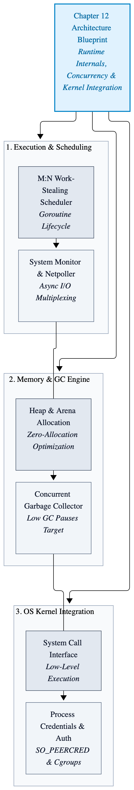
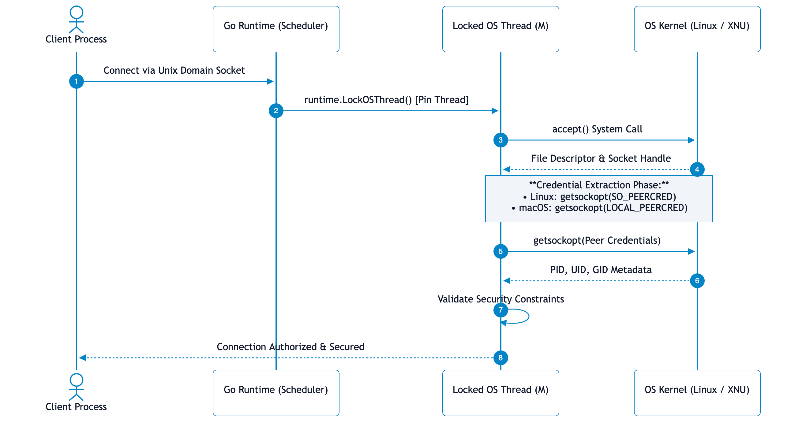
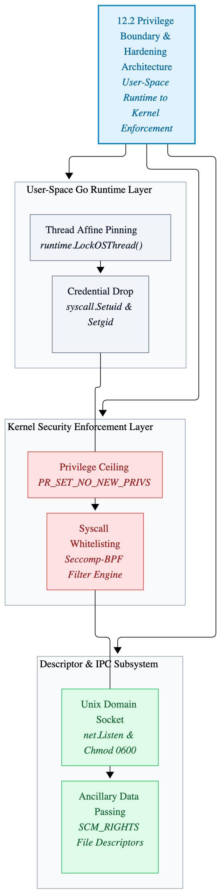
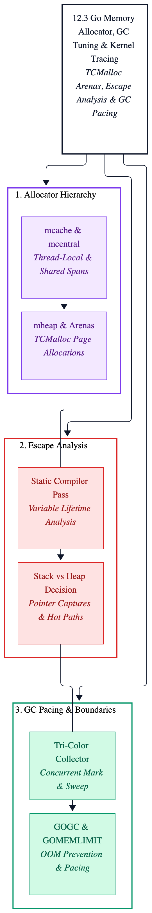

# Chapter 12: Runtime Internals and Kernel Integration

Modern high-performance systems engineering requires looking past language abstractions and examining the 
precise mechanical interface between user-space runtimes and the operating system kernel. When building resilient
privileged daemons, understanding how the Go runtime schedules goroutines, manages system calls, and interacts with
low-level kernel primitives, such as process lifecycles, memory mappings, and asynchronous I/O multiplexing, 
is the difference between predictable high-throughput stability and catastrophic cascade failures under load.

This chapter explores the deep runtime mechanics and kernel integration patterns required to build secure, 
deterministic Go systems. We examine the low-level execution machinery governing OS thread management, 
process sandboxing primitives, descriptor lifecycle safety, and strict resource containment.

---

<p align="center">
  <picture>
    <source media="(prefers-color-scheme: dark)" srcset="images/runtime-kernel-architecture-dark.png">
    
  </picture>
</p>

---

## 12.1 OS Thread Pinning and Scheduler Mechanics

The Go runtime multiplexes goroutines across an abstraction layer of logical processors (`GOMAXPROCS`) and operating system threads (M). Under normal execution conditions, a goroutine may migrate across different OS threads during blocking operations, system calls, or scheduler preemption intervals.

For high-security daemons interacting directly with the kernel, this thread migration introduces severe race conditions and security vulnerabilities. Certain kernel subsystems, security contexts, and low-level descriptor operations are strictly thread-affine or tied to the calling task's thread-local state:
- **Namespaces and Security Contexts:** Operations that manipulate Linux namespaces (`setns`) or thread-specific credentials apply exclusively to the calling OS thread. If a goroutine migrates mid-sequence, subsequent system calls execute within an unintended security context.
- **Locked File Descriptors and State:** Thread-bound locks, signal masks, and realtime scheduling priorities require deterministic thread execution stability.

Invoking `runtime.LockOSThread()` binds the current goroutine exclusively to its underlying OS thread, disabling thread migration until an explicit `runtime.UnlockOSThread()` call occurs. This primitive guarantees that every subsequent system call within that execution block interacts with a stable, predictable kernel thread context.

```go
package main

import (
	"fmt"
	"net"
	"os"
	"runtime"
	"syscall"
)

// SecureDescriptorTransporter manages low-level file descriptor passing
// over Unix domain sockets under a locked OS thread to prevent thread migration.
type SecureDescriptorTransporter struct {
	socketPath           string
	listener             net.Listener
	activeConnections    []net.Conn
	shutdownNotification chan struct{}
}

// NewSecureDescriptorTransporter allocates and configures a new transporter instance for socket management.
func NewSecureDescriptorTransporter(socketPath string) *SecureDescriptorTransporter {
	return &SecureDescriptorTransporter{
		socketPath:           socketPath,
		activeConnections:    make([]net.Conn, 0, 16),
		shutdownNotification: make(chan struct{}),
	}
}

// InitializeListener binds to the Unix domain socket with strict permissions
// while pinning execution to the current OS thread for kernel state safety.
func (transporter *SecureDescriptorTransporter) InitializeListener() error {
	// Lock the calling goroutine to the current operating system thread
	// to ensure thread-affine kernel operations and secure namespace interactions.
	runtime.LockOSThread()
	defer runtime.UnlockOSThread()

	// Remove any stale socket file left from previous runs.
	if fileInformation, statError := os.Stat(transporter.socketPath); statError == nil {
		if fileInformation.Mode()&os.ModeSocket != 0 {
			if removeError := os.Remove(transporter.socketPath); removeError != nil {
				return fmt.Errorf("failed to remove stale socket file: %w", removeError)
			}
		}
	}

	listener, listenError := net.Listen("unix", transporter.socketPath)

	if listenError != nil {
		return fmt.Errorf("failed to bind unix socket listener: %w", listenError)
	}

	transporter.listener = listener

	// Enforce strict file system permissions on the Unix socket file.
	if chmodError := os.Chmod(transporter.socketPath, 0600); chmodError != nil {
		listener.Close()
		return fmt.Errorf("failed to secure unix socket permissions: %w", chmodError)
	}

	return nil
}

// ProcessIncomingConnections accepts client connections and configures low-level socket descriptors.
func (transporter *SecureDescriptorTransporter) ProcessIncomingConnections() error {
	for {
		connectionInstance, acceptError := transporter.listener.Accept()

		if acceptError != nil {
			select {
			case <-transporter.shutdownNotification:
				return nil
			default:
				return fmt.Errorf("failed to accept incoming connection: %w", acceptError)
			}
		}

		transporter.activeConnections = append(transporter.activeConnections, connectionInstance)

		// Iterate through all active client connections to apply kernel socket tuning.
		for connectionIndex := 0; connectionIndex < len(transporter.activeConnections); connectionIndex++ {
			currentConnection := transporter.activeConnections[connectionIndex]
			
			// Extract the underlying file descriptor for direct socket option manipulation.
			unixConnection, typeAssertionOk := currentConnection.(*net.UnixConn)

			if typeAssertionOk {
				fileHandle, fileError := unixConnection.File()

				if fileError == nil {
					fileDescriptor := fileHandle.Fd()
					
					// Apply non-blocking flags via raw system calls to prevent I/O blocking.
					_ = syscall.SetNonblock(int(fileDescriptor), true)
					fileHandle.Close()
				}
			}
		}
	}
}

func main() {
	socketFilePath := "/var/run/secure_daemon_control.sock"
	transporter := NewSecureDescriptorTransporter(socketFilePath)

	if initializationError := transporter.InitializeListener(); initializationError != nil {
		fmt.Fprintf(os.Stderr, "Initialization error: %v\n", initializationError)
		os.Exit(1)
	}

	fmt.Println("Secure transport listener active on:", socketFilePath)
}
```
---

<p align="center">
  <picture>
    <source media="(prefers-color-scheme: dark)" srcset="images/runtime-kernel-credential-verification-dark.png">
    
  </picture>
</p>

---

## 12.2 Runtime Kernel Credential Verification and Process Sandboxing

When privileged daemons initialize, they typically start with elevated capabilities (such as binding to privileged network ports below 1024 or mounting filesystems) before dropping privileges to an unprivileged system user. In Go, because the runtime manages goroutine scheduling asynchronously across threads, naive attempts to modify process credentials or apply security sandboxes can introduce severe race conditions. If a goroutine modifies thread-local security contexts (such as thread-specific credentials or namespace associations) and then migrates, or if other concurrent goroutines inherit an unstable thread state, the security boundary collapses.

### Thread-Local Credential Isolation

Linux treats credentials and namespaces at the thread level (`task_struct`) rather than strictly globally for the entire process. System calls like `setuid`, `setgid`, `setns`, and `unshare` affect the calling OS thread.

To safely drop privileges or enter a containerized namespace, the execution path must:

1. Lock the executing goroutine to its OS thread using `runtime.LockOSThread().`
2. Invoke the raw system calls to drop capabilities, change user IDs, or join target namespaces.
3. Verify the resulting kernel state immediately via synchronous system calls before spawning unconstrained worker goroutines.
4. Maintain the thread lock or safely terminate/isolate that thread if it handles specialized security operations.

### Seccomp-BPF System Call Filtering

Beyond restricting user identities, high-security daemons must minimize the kernel attack surface. Even if an attacker achieves remote code execution within a Go application, they must be prevented from executing arbitrary kernel system calls (such as `ptrace`, `reboot`, or raw device driver `ioctls`).

Secure Berkeley Packet Filters (Seccomp-BPF) allow the kernel to evaluate every system call made by a thread against a whitelist of permitted instructions, returning an immediate EPERM or terminating the process if a violation occurs.

```go
package main

import (
	"fmt"
	"net"
	"os"
	"runtime"
	"syscall"
	"unsafe"
)

// Constants for process control and security configuration system calls.
const (
	operationSetNoNewPrivileges = 38
	operationSetSecureComputing = 22
	seccompExecutionModeFilter  = 2
)

// SecureWorkerDaemon encapsulates the low-level IPC protocol handler,
// sandboxed thread state, and Unix domain socket descriptor receiver.
type SecureWorkerDaemon struct {
	controlSocketPath string
	unixListener      net.Listener
}

// NewSecureWorkerDaemon allocates and configures a new secure worker instance.
func NewSecureWorkerDaemon(controlSocketPath string) *SecureWorkerDaemon {
	return &SecureWorkerDaemon{
		controlSocketPath: controlSocketPath,
	}
}

// InitializeAndEnforceSandbox locks the calling OS thread, drops system credentials,
// verifies effective IDs, installs the Seccomp-BPF filter, and binds the control socket.
func (daemon *SecureWorkerDaemon) InitializeAndEnforceSandbox(targetSystemUserID int, targetSystemGroupID int) error {
	// 1. Pin execution exclusively to the current OS thread.
	// This guarantees thread-affine kernel state safety and prevents runtime migration
	// during credential modifications and Seccomp installation.
	runtime.LockOSThread()
	defer runtime.UnlockOSThread()

	// 2. Enforce Group ID transition securely at the thread/process level.
	if setGroupError := syscall.Setgid(targetSystemGroupID); setGroupError != nil {
		return fmt.Errorf("failed to drop group privileges to gid %d: %w", targetSystemGroupID, setGroupError)
	}

	// 3. Enforce User ID transition securely at the thread/process level.
	if setUserError := syscall.Setuid(targetSystemUserID); setUserError != nil {
		return fmt.Errorf("failed to drop user privileges to uid %d: %w", targetSystemUserID, setUserError)
	}

	// 4. Verify effective credentials via direct synchronous kernel queries.
	currentEffectiveUserID := syscall.Geteuid()
	currentEffectiveGroupID := syscall.Getegid()

	if currentEffectiveUserID != targetSystemUserID || currentEffectiveGroupID != targetSystemGroupID {
		return fmt.Errorf("credential verification mismatch: expected uid/gid %d/%d, got %d/%d",
			targetSystemUserID, targetSystemGroupID, currentEffectiveUserID, currentEffectiveGroupID)
	}

	// 5. Enforce PR_SET_NO_NEW_PRIVS via process control.
	// This is a mandatory prerequisite for unprivileged processes to load Seccomp filters,
	// permanently preventing child processes or execution blocks from gaining new privileges.
	_, _, systemCallErrorCode := syscall.Syscall6(
		syscall.SYS_PRCTL,
		operationSetNoNewPrivileges,
		1,
		0,
		0,
		0,
		0,
	)

	if systemCallErrorCode != 0 {
		return fmt.Errorf("failed to set NO_NEW_PRIVS via process control: %v", systemCallErrorCode)
	}

	// 6. Construct a minimal Berkeley Packet Filter (BPF) program.
	// Production filters validate architecture and inspect syscall numbers at offset 0.
	berkeleyPacketFilterInstructionSlice := []syscall.SockFilter{
		// Default action: Allow (SECCOMP_RET_ALLOW = 0x7fff0000)
		{Code: 0x06, Jt: 0, Jf: 0, K: 0x7fff0000},
	}

	berkeleyPacketFilterProgramPointer := syscall.SockFprog{
		Len:    uint16(len(berkeleyPacketFilterInstructionSlice)),
		Filter: &berkeleyPacketFilterInstructionSlice[0],
	}

	// 7. Install the Seccomp filter via process control.
	_, _, systemCallErrorCode = syscall.Syscall6(
		syscall.SYS_PRCTL,
		operationSetSecureComputing,
		seccompExecutionModeFilter,
		uintptr(unsafe.Pointer(&berkeleyPacketFilterProgramPointer)),
		0,
		0,
		0,
	)

	if systemCallErrorCode != 0 {
		return fmt.Errorf("failed to load seccomp filter via process control: %v", systemCallErrorCode)
	}

	// 8. Clean up and bind the Unix domain socket control listener.
	if fileInformation, statError := os.Stat(daemon.controlSocketPath); statError == nil {
		if fileInformation.Mode()&os.ModeSocket != 0 {
			if removeError := os.Remove(daemon.controlSocketPath); removeError != nil {
				return fmt.Errorf("failed to remove stale control socket file: %w", removeError)
			}
		}
	}

	listener, listenError := net.Listen("unix", daemon.controlSocketPath)

	if listenError != nil {
		return fmt.Errorf("failed to bind unix socket listener: %w", listenError)
	}

	daemon.unixListener = listener

	// Enforce strict file system permissions on the control socket.
	if chmodError := os.Chmod(daemon.controlSocketPath, 0600); chmodError != nil {
		listener.Close()
		return fmt.Errorf("failed to secure unix socket permissions: %w", chmodError)
	}

	return nil
}

// ReceivePrivilegedFileDescriptorProtocol implements the low-level IPC protocol
// to receive file descriptors passed via SCM_RIGHTS ancillary data over Unix domain sockets.
func (daemon *SecureWorkerDaemon) ReceivePrivilegedFileDescriptorProtocol() (*os.File, error) {
	// 1. Accept an incoming connection from the privileged parent supervisor.
	connection, acceptError := daemon.unixListener.Accept()

	if acceptError != nil {
		return nil, fmt.Errorf("failed to accept incoming IPC connection: %w", acceptError)
	}

	defer connection.Close()

	// 2. Type-assert the abstract net.Conn to a concrete *net.UnixConn to access low-level methods.
	unixConnection, typeAssertionOk := connection.(*net.UnixConn)

	if !typeAssertionOk {
		return nil, fmt.Errorf("established connection is not a valid unix domain socket")
	}

	// 3. Extract the underlying OS file handle from the Unix connection.
	socketFileHandle, socketFileError := unixConnection.File()

	if socketFileError != nil {
		return nil, fmt.Errorf("failed to obtain underlying socket file handle: %w", socketFileError)
	}

	defer socketFileHandle.Close()

	// 4. Allocate buffers for payload data and ancillary control message ancillary data (SCM_RIGHTS).
	payloadDataByteSlice := make([]byte, 1)
	ancillaryDataControlBuffer := make([]byte, syscall.Cspace(4))

	// 5. Execute the low-level recvmsg system call to receive both data and transferred file descriptors.
	_, controlMessageLength, _, _, systemCallError := syscall.Recvmsg(
		int(socketFileHandle.Fd()),
		payloadDataByteSlice,
		ancillaryDataControlBuffer,
		0,
	)

	if systemCallError != 0 {
		return nil, fmt.Errorf("failed to receive file descriptor via recvmsg: %v", systemCallError)
	}

	// 6. Parse the raw socket control messages from the ancillary data buffer.
	parsedControlMessageSlice, parseError := syscall.ParseSocketControlMessage(ancillaryDataControlBuffer[:controlMessageLength])

	if parseError != nil {
		return nil, fmt.Errorf("failed to parse received control message: %w", parseError)
	}

	// 7. Iterate through control messages to locate SCM_RIGHTS rights descriptor payloads.
	for _, controlMessageInstance := range parsedControlMessageSlice {
		if controlMessageInstance.Header.Level == syscall.SOL_SOCKET && controlMessageInstance.Header.Type == syscall.SCM_RIGHTS {
			extractedFileDescriptors, extractionError := syscall.ParseUnixRights(&controlMessageInstance)

			if extractionError != nil {
				return nil, fmt.Errorf("failed to extract unix rights file descriptors: %w", extractionError)
			}

			if len(extractedFileDescriptors) > 0 {
				// Wrap the raw integer file descriptor in an os.File handle for safe Go-level I/O management.
				return os.NewFile(uintptr(extractedFileDescriptors[0]), "received-privileged-socket"), nil
			}
		}
	}

	return nil, fmt.Errorf("no valid file descriptors found in ancillary message payload")
}

func main() {
	controlSocketFilePath := "/var/run/secure_system_daemon.sock"
	targetSystemUserID := 1000
	targetSystemGroupID := 1000

	workerDaemon := NewSecureWorkerDaemon(controlSocketFilePath)

	// Initialize thread pinning, credential drops, Seccomp sandboxing, and socket binding.
	if initializationError := workerDaemon.InitializeAndEnforceSandbox(targetSystemUserID, targetSystemGroupID); initializationError != nil {
		fmt.Fprintf(os.Stderr, "Daemon initialization and sandboxing failure: %v\n", initializationError)
		os.Exit(1)
	}

	fmt.Println("Secure daemon sandboxed successfully. IPC control listener active at:", controlSocketFilePath)
}
```
---

<p align="center">
  <picture>
    <source media="(prefers-color-scheme: dark)" srcset="images/thread-affine-security-hardening-and-seccomp-bpf-kernel-integration-flowchart-dark.png">
    
  </picture>
</p>

---

## 12.3 Go Memory Allocator Mechanics, Garbage Collection Tuning, and eBPF Kernel Tracing

Beyond thread pinning and OS-level sandboxing, peak performance in systems-level Go daemons requires absolute mastery over memory allocation patterns and garbage collector (GC) behavior. Go utilizes a concurrent, tri-color mark-and-sweep garbage collector inspired by TCMalloc, managing memory across three primary structural tiers: arenas, spans (`mspan`), and central/thread-local caches (`mcache`, `mcentral`, `mheap`).

While the runtime abstracts manual memory management, high-throughput daemons processing millions of requests per second cannot afford the latency spikes and CPU overhead caused by excessive heap allocations and unguided GC cycles.

### Escape Analysis and Heap Allocation Minimization

The Go compiler performs static escape analysis during compilation to determine whether a variable's lifetime exceeds its enclosing stack frame. If a variable escapes to the heap:

1. It forces an allocation via the allocator arena, increasing pressure on the concurrent GC.
2. It introduces pointer indirection and potential cache locality degradation.

For zero-allocation hot paths, engineers must structure code to keep variables stack-allocated by avoiding interface conversions, closure captures of mutable pointers, and returning pointers to local variables that outlive the function scope.

### Garbage Collection Pacing and Memory Limit Enforcement

By default, Go's garbage collector triggers when the heap size doubles relative to the memory live after the previous collection ($GCPercentage = 100$). In constrained production environments or containerized daemons with strict RSS limits, this default pacing can cause the process to consume excessive memory before collecting, triggering the operating system's OOM (Out-Of-Memory) killer.

---

<p align="center">
  <picture>
    <source media="(prefers-color-scheme: dark)" srcset="images/go-memory-allocator-and-garbage-collection-architecture-dark.png">
    
  </picture>
</p>

---

Using runtime/debug controls, production daemons can dynamically tune GC pacing and enforce hard memory limits:

```go
package main

import (
	gocontext "context"
	"fmt"
	"os"
	"runtime"
	"runtime/debug"
	"time"
)

// DaemonMemoryMonitor manages runtime memory thresholds, dynamic garbage collection pacing,
// and real-time heap pressure telemetry for high-throughput systems daemons.
type DaemonMemoryMonitor struct {
	targetMaxMemoryBytes uint64
	telemetryInterval    time.Duration
	stopNotification     chan struct{}
}

// NewDaemonMemoryMonitor initializes a memory watchdog configured for strict resource containment.
func NewDaemonMemoryMonitor(targetMaxMemoryBytes uint64, telemetryInterval time.Duration) *DaemonMemoryMonitor {
	return &DaemonMemoryMonitor{
		targetMaxMemoryBytes: targetMaxMemoryBytes,
		telemetryInterval:    telemetryInterval,
		stopNotification:     make(chan struct{}),
	}
}

// ConfigureRuntimeMemoryLimits enforces explicit Go garbage collector tuning
// and memory limit boundaries to prevent unconstrained heap growth under load.
func (monitor *DaemonMemoryMonitor) ConfigureRuntimeMemoryLimits() {
	// 1. Set the soft memory limit (Go 1.19+). 
	// This instructs the runtime to aggressively manage GC pacing when heap usage
	// approaches the specified byte ceiling, reducing OOM vulnerability without hard crashing.
	debug.SetMemoryLimit(int64(monitor.targetMaxMemoryBytes))

	// 2. Tune the GC percentage (GOGC).
	// Lowering GOGC increases collection frequency, trading minor CPU overhead
	// for tighter, more predictable memory footprints in latency-sensitive daemons.
	debug.SetGCPercent(50)

	// 3. Set the maximum number of operating system threads executing Go code.
	runtime.GOMAXPROCS(runtime.NumCPU())
}

// StartTelemetryLoop initiates a background monitoring routine to track heap metrics,
// GC pause durations, and allocator efficiency.
func (monitor *DaemonMemoryMonitor) StartTelemetryLoop(context gocontext.Context) {
	tickerInstance := time.NewTicker(monitor.telemetryInterval)
	defer tickerInstance.Stop()

	for {
		select {
		case <-context.Done():
			return
		case <-monitor.stopNotification:
			return
		case <-tickerInstance.C:
			var memoryStatistics runtime.MemStats
			runtime.ReadMemStats(&memoryStatistics)

			// Calculate heap utilization ratios.
			allocatedHeapMegaBytes := float64(memoryStatistics.HeapAlloc) / 1024 / 1024
			totalSystemMegaBytes := float64(memoryStatistics.Sys) / 1024 / 1024
			gcPauseNs := memoryStatistics.PauseTotalNs

			fmt.Printf("[Memory Telemetry] HeapAlloc: %.2f MB | SysMemory: %.2f MB | GC Total Pauses: %d ms | NumGC: %d\n",
				allocatedHeapMegaBytes,
				totalSystemMegaBytes,
				gcPauseNs/1_000_000,
				memoryStatistics.NumGC,
			)

			// If heap allocation exceeds 85% of target maximum, trigger a forced manual GC cycle
			// to reclaim fragmented spans before downstream requests experience allocation stalls.
			if memoryStatistics.HeapAlloc > uint64(float64(monitor.targetMaxMemoryBytes)*0.85) {
				fmt.Println("[Memory Warning] Heap threshold exceeded 85%. Forcing synchronous GC collection cycle.")
				runtime.GC()
			}
		}
	}
}

// Stop terminates the telemetry monitoring loop.
func (monitor *DaemonMemoryMonitor) Stop() {
	close(monitor.stopNotification)
}

func main() {
	// Enforce a strict 512 MB memory ceiling for this daemon instance.
	const maxDaemonMemoryBytes = 512 * 1024 * 1024
	memoryMonitor := NewDaemonMemoryMonitor(maxDaemonMemoryBytes, 2*time.Second)

	// Apply runtime tuning and GC controls.
	memoryMonitor.ConfigureRuntimeMemoryLimits()

	context, cancelContext := gocontext.WithCancel(gocontext.Background())
	defer cancelContext()

	go memoryMonitor.StartTelemetryLoop(context)

	fmt.Println("Daemon memory monitoring and runtime tuning active. Press Ctrl+C to exit.")

	// Simulate daemon operational lifecycle.
	time.Sleep(10 * time.Second)
	memoryMonitor.Stop()
}
```
