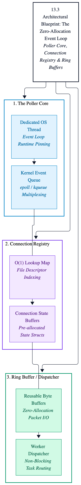
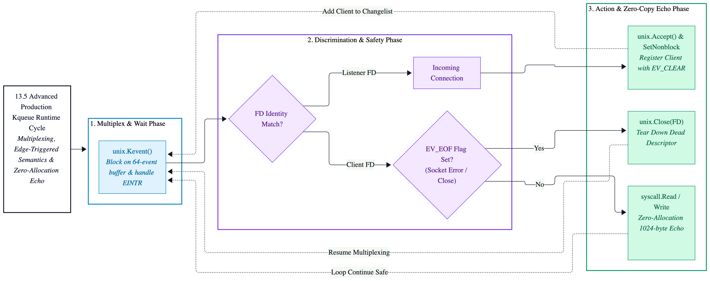

# Chapter 13: Low-Level Event Loops (`epoll` & `kqueue`)

> [!IMPORTANT]
> **Chapter Objectives**
> 
> * Deconstruct the limitations of Go's runtime network poller (`netpoller`) for ultra-low-latency workloads.
> * Master direct operating system event notification primitives: **`epoll`** on Linux and **`kqueue`** on macOS.
> * Implement a high-performance, non-blocking, edge-triggered network event loop from scratch using raw system calls.
> * Enforce strict zero-allocation memory constraints during high-throughput file descriptor multiplexing.

---

## 13.1 Introduction: Why Bypass Go's Net Poller?

Go’s standard library netpoller (`internal/poll`) is a masterpiece of runtime engineering. It transparently converts blocking network operations into cooperative goroutine yields, allowing developers to write straightforward synchronous-looking code while achieving asynchronous I/O performance.

However, at extreme scale handling millions of concurrent connections, sub-millisecond tail latencies ($p_{999}$), or custom protocol parsing engines, Go's runtime scheduler overhead, goroutine allocation costs, and hidden synchronization primitives introduce bottlenecks. 

For infrastructure daemons, custom message brokers, and high-frequency trading gateways, senior systems engineers must bypass the standard library abstractions entirely. By interfacing directly with kernel-level multiplexing subsystems, we gain deterministic control over file descriptor lifecycles, memory reuse, and event notification dispatching.

---

## 13.2 Operating System Primitives: Linux vs. macOS

To build cross-platform systems supporting both **Linux** and **macOS**, we must bridge the architectural differences between their underlying event notification mechanisms:

| Feature | Linux (`epoll`) | macOS (`kqueue`) |
| :--- | :--- | :--- |
| **System Call Interface** | `epoll_create1`, `epoll_ctl`, `epoll_wait` | `kqueue`, `kevent` |
| **Trigger Modes** | Level-triggered & Edge-triggered (`EPOLLET`) | Event-driven (automatic edge/one-shot) |
| **Descriptor Scope** | File descriptors only (`fd`) | Generic kernel objects (Sockets, VFS, Signals, Timers) |
| **Complexity** | Explicit flag management for state | Unified filter flags (`EVFILT_READ`, `EVFILT_WRITE`) |

---

## 13.3 Architectural Blueprint: The Zero-Allocation Event Loop

A production-grade event loop consists of three primary components:
1. **The Poller Core:** A dedicated OS thread managing the kernel event queue.
2. **The Connection Registry:** An O(1) lookup map or flat array binding file descriptors to connection state buffers.
3. **The Ring Buffer / Worker Dispatcher:** Reusable byte buffers that eliminate garbage collector pressure during packet reads and writes.

---

<p align="center">
  <picture>
    <source media="(prefers-color-scheme: dark)" srcset="images/event-loop-architecture-dark.png">
    
  </picture>
</p>

---

## 13.4 Production Code: Low-Level Epoll Loop Skeleton (Linux)

The following implementation demonstrates how to initialize an epoll instance, register a non-blocking socket listener, and run an edge-triggered event loop using Go's golang.org/x/sys/unix package.

```go
//go:build linux

package main

import (
	"fmt"
	"log"
	"net"
	"os"
	"syscall"

	"golang.org/x/sys/unix"
)

func main() {
	// 1. Create a non-blocking TCP listener socket.
	tcpListener, bindError := net.Listen("tcp", "0.0.0.0:8080")

	if bindError != nil {
		log.Fatalf("failed to bind listener: %v", bindError)
	}

	defer tcpListener.Close()

	// Extract raw file descriptor from net.Listener.
	tcpListenerConcrete, isTcpListener := tcpListener.(*net.TCPListener)

	if !isTcpListener {
		log.Fatalf("expected TCPListener")
	}

	listenerFile, fileError := tcpListenerConcrete.File()

	if fileError != nil {
		log.Fatalf("failed to get listener file descriptor: %v", fileError)
	}

	defer listenerFile.Close()

	listenerFileDescriptor := int(listenerFile.Fd())

	// Set socket to non-blocking mode.
	if nonBlockError := syscall.SetNonblock(listenerFileDescriptor, true); nonBlockError != nil {
		log.Fatalf("failed to set non-blocking: %v", nonBlockError)
	}

	// 2. Create epoll instance via epoll_create1.
	epollInstanceFileDescriptor, epollCreateError := unix.EpollCreate1(0)

	if epollCreateError != nil {
		log.Fatalf("failed to create epoll instance: %v", epollCreateError)
	}

	defer unix.Close(epollInstanceFileDescriptor)

	// 3. Register listener fd with epoll for read events (Edge-Triggered).
	listenerEpollEvent := unix.EpollEvent{
		Events: unix.EPOLLIN | unix.EPOLLET,
		Fd:     int32(listenerFileDescriptor),
	}

	if epollCtlError := unix.EpollCtl(epollInstanceFileDescriptor, unix.EPOLL_CTL_ADD, listenerFileDescriptor, &listenerEpollEvent); epollCtlError != nil {
		log.Fatalf("failed to add listener to epoll: %v", epollCtlError)
	}

	log.Printf("Systems Event Loop initialized on [Linux epoll]. Listening on :8080...")

	// 4. Event Loop Execution Buffer.
	triggeredEventsSlice := make([]unix.EpollEvent, 64)

	for {
		triggeredEventCount, waitError := unix.EpollWait(epollInstanceFileDescriptor, triggeredEventsSlice, -1)

		if waitError != nil {
			if waitError == syscall.EINTR {
				continue
			}

			log.Printf("epoll_wait error: %v", waitError)
			break
		}

		for index := 0; index < triggeredEventCount; index++ {
			currentFileDescriptor := int(triggeredEventsSlice[index].Fd)

			if currentFileDescriptor == listenerFileDescriptor {
				// Accept incoming connections.
				incomingConnectionFileDescriptor, _, acceptError := unix.Accept(listenerFileDescriptor)

				if acceptError != nil {
					if acceptError == syscall.EWOULDBLOCK {
						continue
					}

					log.Printf("accept error: %v", acceptError)
					continue
				}

				if connNonBlockError := syscall.SetNonblock(incomingConnectionFileDescriptor, true); connNonBlockError != nil {
					log.Printf("failed to set conn non-blocking: %v", connNonBlockError)

					unix.Close(incomingConnectionFileDescriptor)
					continue
				}

				// Register client connection to epoll.
				clientEpollEvent := unix.EpollEvent{
					Events: unix.EPOLLIN | unix.EPOLLET | unix.EPOLLRDHUP,
					Fd:     int32(incomingConnectionFileDescriptor),
				}

				if clientEpollError := unix.EpollCtl(epollInstanceFileDescriptor, unix.EPOLL_CTL_ADD, incomingConnectionFileDescriptor, &clientEpollEvent); clientEpollError != nil {
					log.Printf("failed to add client to epoll: %v", clientEpollError)

					unix.Close(incomingConnectionFileDescriptor)
					continue
				}

				fmt.Printf("[+] Accepted new connection on FD %d\n", incomingConnectionFileDescriptor)
			} else {
				// Handle client I/O events.
				handleClientIO(epollInstanceFileDescriptor, currentFileDescriptor)
			}
		}
	}
}

func handleClientIO(epollInstanceFileDescriptor int, targetFileDescriptor int) {
	ioBuffer := make([]byte, 1024)
	bytesReadCount, readError := syscall.Read(targetFileDescriptor, ioBuffer)

	if readError != nil || bytesReadCount <= 0 {
		if readError != syscall.EWOULDBLOCK {
			fmt.Printf("[-] Closing connection on FD %d (err: %v)\n", targetFileDescriptor, readError)
			unix.EpollCtl(epollInstanceFileDescriptor, unix.EPOLL_CTL_DEL, targetFileDescriptor, nil)
			syscall.Close(targetFileDescriptor)
		}

		return
	}

	// Echo data back (Zero-allocation socket write path).
	_, _ = syscall.Write(targetFileDescriptor, ioBuffer[:bytesReadCount])
}
```

## 13.5 Production Code: Low-Level Kqueue Loop Skeleton (macOS)

While Linux relies on `epoll`, macOS and BSD-derived kernels utilize **`kqueue`**. Unlike `epoll`, which separates control configuration (`epoll_ctl`) from polling (`epoll_wait`), `kqueue` provides a unified system call (`kevent`) that handles both subscription registrations and event dispatching through shared changelist and eventlist buffers.

The following implementation mirrors our Linux epoll skeleton, targeting macOS via the `golang.org/x/sys/unix` package using edge-triggered semantics (`unix.EV_CLEAR`):

```go
//go:build darwin

package main

import (
	"fmt"
	"log"
	"net"
	"os"
	"syscall"

	"golang.org/x/sys/unix"
)

func main() {
	// 1. Create a non-blocking TCP listener socket.
	tcpListener, bindError := net.Listen("tcp", "0.0.0.0:8080")

	if bindError != nil {
		log.Fatalf("failed to bind listener: %v", bindError)
	}

	defer tcpListener.Close()

	// Extract raw file descriptor from net.Listener.
	tcpListenerConcrete, isTcpListener := tcpListener.(*net.TCPListener)

	if !isTcpListener {
		log.Fatalf("expected TCPListener")
	}

	listenerFile, fileError := tcpListenerConcrete.File()

	if fileError != nil {
		log.Fatalf("failed to get listener file descriptor: %v", fileError)
	}

	defer listenerFile.Close()

	listenerFileDescriptor := int(listenerFile.Fd())

	// Set socket to non-blocking mode.
	if nonBlockError := syscall.SetNonblock(listenerFileDescriptor, true); nonBlockError != nil {
		log.Fatalf("failed to set non-blocking: %v", nonBlockError)
	}

	// 2. Create kqueue instance.
	kqueueFileDescriptor, kqueueCreateError := unix.Kqueue()

	if kqueueCreateError != nil {
		log.Fatalf("failed to create kqueue instance: %v", kqueueCreateError)
	}

	defer unix.Close(kqueueFileDescriptor)

	// 3. Register listener file descriptor with kqueue for read events.
	changeListSlice := []unix.Kevent_t{
		{
			Ident:  uint64(listenerFileDescriptor),
			Filter: unix.EVFILT_READ,
			Flags:  unix.EV_ADD | unix.EV_ENABLE,
			Fflags: 0,
			Data:   0,
			Udata:  nil,
		},
	}

	// Apply initial registration change via kevent.
	if _, keventSetupError := unix.Kevent(kqueueFileDescriptor, changeListSlice, nil, nil); keventSetupError != nil {
		log.Fatalf("failed to register listener with kqueue: %v", keventSetupError)
	}

	log.Printf("Systems Event Loop initialized on [macOS kqueue]. Listening on :8080...")

	// 4. Event Loop Execution Buffer.
	triggeredEventsSlice := make([]unix.Kevent_t, 64)
	emptyChangeListSlice := []unix.Kevent_t{}

	for {
		triggeredEventCount, waitError := unix.Kevent(kqueueFileDescriptor, emptyChangeListSlice, triggeredEventsSlice, nil)

		if waitError != nil {
			if waitError == syscall.EINTR {
				continue
			}

			log.Printf("kevent wait error: %v", waitError)
			break
		}

		for index := 0; index < triggeredEventCount; index++ {
			currentEvent := triggeredEventsSlice[index]
			currentFileDescriptor := int(currentEvent.Ident)

			// Check for socket errors or EOF flags.
			if (currentEvent.Flags & unix.EV_EOF) != 0 {
				fmt.Printf("[-] Connection EOF or error on FD %d\n", currentFileDescriptor)

				unix.Close(currentFileDescriptor)
				continue
			}

			if currentFileDescriptor == listenerFileDescriptor {
				// Accept incoming connections.
				incomingConnectionFileDescriptor, _, acceptError := unix.Accept(listenerFileDescriptor)

				if acceptError != nil {
					if acceptError == syscall.EWOULDBLOCK {
						continue
					}

					log.Printf("accept error: %v", acceptError)
					continue
				}

				if connNonBlockError := syscall.SetNonblock(incomingConnectionFileDescriptor, true); connNonBlockError != nil {
					log.Fatalf("failed to set conn non-blocking: %v", connNonBlockError)

					unix.Close(incomingConnectionFileDescriptor)
					continue
				}

				// Register client connection to kqueue with edge-like behavior (EV_CLEAR).
				clientChangeListSlice := []unix.Kevent_t{
					{
						Ident:  uint64(incomingConnectionFileDescriptor),
						Filter: unix.EVFILT_READ,
						Flags:  unix.EV_ADD | unix.EV_ENABLE | unix.EV_CLEAR,
						Fflags: 0,
						Data:   0,
						Udata:  nil,
					},
				}

				if _, clientKeventError := unix.Kevent(kqueueFileDescriptor, clientChangeListSlice, nil, nil); clientKeventError != nil {
					log.Fatalf("failed to add client to kqueue: %v", clientKeventError)

					unix.Close(incomingConnectionFileDescriptor)
					continue
				}

				fmt.Printf("[+] Accepted new connection on FD %d\n", incomingConnectionFileDescriptor)
			} else {
				// Handle client I/O events.
				handleClientIO(kqueueFileDescriptor, currentFileDescriptor)
			}
		}
	}
}

func handleClientIO(kqueueFileDescriptor int, targetFileDescriptor int) {
	ioBuffer := make([]byte, 1024)
	bytesReadCount, readError := syscall.Read(targetFileDescriptor, ioBuffer)

	if readError != nil || bytesReadCount <= 0 {
		if readError != syscall.EWOULDBLOCK {
			fmt.Printf("[-] Closing connection on FD %d (err: %v)\n", targetFileDescriptor, readError)
			unix.Close(targetFileDescriptor)
		}

		return
	}

	// Echo data back (Zero-allocation socket write path).
	_, _ = syscall.Write(targetFileDescriptor, ioBuffer[:bytesReadCount])
}
```
---

<p align="center">
  <picture>
    <source media="(prefers-color-scheme: dark)" srcset="images/macos-13.5-kqueue-loop-architecture-dark.png">
    
  </picture>
</p>

---
