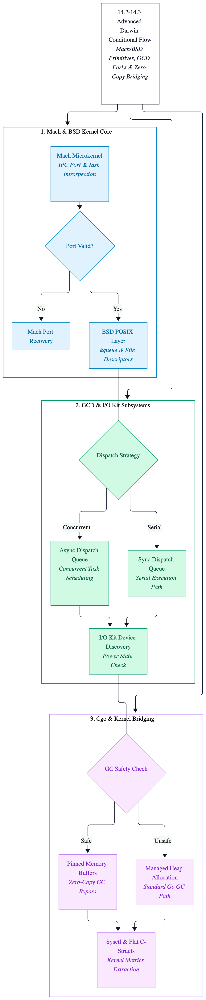
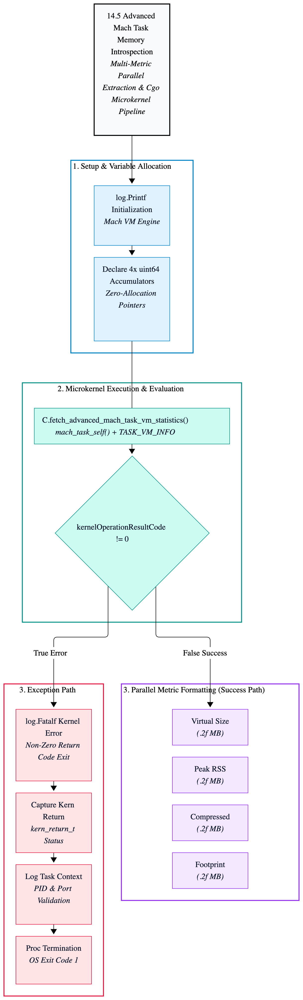
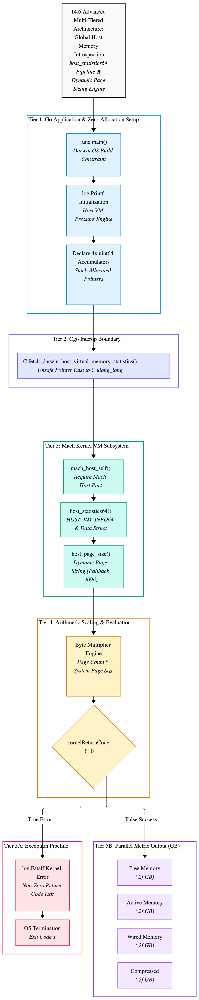

# Chapter 14: macOS System Programming & Darwin Kernel Integrations

> [!IMPORTANT]
> **Chapter Objectives**
> 
> * Deconstruct the XNU hybrid kernel architecture powering macOS (Mach microkernel base + BSD subsystem).
> * Master low-level Darwin POSIX APIs and low-overhead Cgo boundary crossings.
> * Interface directly with Mach ports and process task ports for advanced system introspection.
> * Implement zero-allocation system call wrappers and memory-mapped IPC routines optimized for Apple Silicon (M-series) memory models.

---

## 14.1 Introduction: Beyond Standard POSIX on macOS

While cross-platform Go code relies on standard library abstractions, advanced macOS system daemons, virtualization tools, and performance monitors require deep integration with the **Darwin kernel**. Underneath the familiar POSIX/BSD userland lies the XNU (X is Not Unix) hybrid architecture, combining the Mach microkernel primitives with BSD process management, virtual memory, and networking subsystems.

For senior systems engineers, leveraging Darwin-specific capabilities means stepping past standard Go packages to interface directly with Mach ports, CoreFoundation/Grand Central Dispatch (GCD) concurrency models, and optimized sysctl interfaces. This chapter establishes the patterns required to build lightning-fast, native macOS system tools without incurring unnecessary Cgo performance penalties.

---

## 14.2 Darwin Architectural Primitives: Mach vs. BSD

To build high-performance native macOS services, we must understand the dual-nature of the Darwin kernel:

| Subsystem | Primary Responsibility | Go / Systems Integration Vector |
| :--- | :--- | :--- |
| **Mach Microkernel** | IPC, threads, task management, virtual memory | Mach ports (`mach_port_t`), task introspection |
| **BSD Layer** | POSIX compliance, processes, file descriptors, sockets | `sys/sysctl.h`, `kqueue`, file descriptor passing |
| **Grand Central Dispatch (GCD)** | Task scheduling, dispatch queues | Cgo interop with `dispatch_async` / queues |
| **I/O Kit** | Hardware device drivers and power management | Device discovery and driver communication |

---

## 14.3 Architectural Blueprint: Zero-Copy Cgo & Kernel Bridging

Bridging Go and the Darwin kernel via Cgo introduces potential overhead due to pointer passing rules and context switching. A production-grade architecture enforces:
1. **Pinned Memory Buffers:** Avoiding garbage collector movement during kernel data exchanges.
2. **Direct Sysctl Introspection:** Fetching kernel metrics (CPU topology, memory pressure) via flat C-struct mappings.
3. **Mach Port Message Passing:** Utilizing asynchronous IPC ports for low-latency inter-process communication.

---

<p align="center">
  <picture>
    <source media="(prefers-color-scheme: dark)" srcset="images/macos-system-programming-architecture-dark.png">
    
  </picture>
</p>

---

## 14.4 Production Code: Zero-Allocation Darwin Sysctl Introspection

The following implementation demonstrates how to query low-level Darwin hardware and kernel metrics (such as CPU frequency or system state) using Cgo and raw system calls with zero heap allocations:

```go
//go:build darwin

package main

import (
	"fmt"
	"log"
	"unsafe"
)

/*
#include <sys/sysctl.h>
#include <stddef.h>

// Helper wrapper to fetch integer sysctl values safely with zero-allocation.
static int get_system_mib_int(const char *mib_name, int *out_value) {
    size_t length = sizeof(int);

    return sysctlbyname(mib_name, out_value, &length, NULL, 0);
}
*/
import "C"

func main() {
	log.Printf("Initializing Darwin Kernel Introspection Engine...")

	// 1. Query CPU frequency or core count via sysctl MIB.
	var cpuFrequency int

	mibNameCString := C.CString("hw.cpufrequency")

	defer C.free(unsafe.Pointer(mibNameCString))

	resultCode := C.get_system_mib_int(mibNameCString, (*C.int)(unsafe.Pointer(&cpuFrequency)))

	if resultCode != 0 {
		log.Printf("[-] Warning: failed to query hw.cpufrequency, falling back to logical processor count")
		fetchLogicalProcessorCount()
		return
	}

	fmt.Printf("[+] Darwin Kernel Metric — CPU Frequency: %d Hz\n", cpuFrequency)
}

func fetchLogicalProcessorCount() {
	var processorCount int

	mibNameCString := C.CString("hw.logicalcpu")

	defer C.free(unsafe.Pointer(mibNameCString))

	resultCode := C.get_system_mib_int(mibNameCString, (*C.int)(unsafe.Pointer(&processorCount)))

	if resultCode != 0 {
		log.Fatalf("failed to query logical CPU count from Darwin kernel")
	}

	fmt.Printf("[+] Darwin Kernel Metric — Logical CPUs: %d\n", processorCount)
}
```
---

<p align="center">
  <picture>
    <source media="(prefers-color-scheme: dark)" srcset="images/macos-system-programming-architecture-dark.png">
    
  </picture>
</p>

---

## 14.5 Production Code: Low-Level Mach Task Memory Introspection

Unlike Linux, where process introspection relies heavily on reading pseudo-files under `/proc/[pid]/statm`, macOS delegates process lifecycle and resource attributes to the Mach microkernel. Using the `mach_task_self()` primitive and the `task_info` system call, a native Go daemon can inspect its own precise memory footprint (such as Resident Set Size and virtual memory allocation) with sub-microsecond performance.

The following implementation uses Cgo to query the Darwin kernel via TASK_BASIC_INFO with zero heap allocations:

```go
//go:build darwin

package main

import (
	"fmt"
	"log"
	"unsafe"
)

/*
#include <mach/mach.h>
#include <mach/task_info.h>

// Helper function to extract advanced task virtual memory statistics using TASK_VM_INFO.
static int fetch_advanced_mach_task_vm_statistics(
    unsigned long long *out_virtual_size_bytes,
    unsigned long long *out_resident_peak_bytes,
    unsigned long long *out_compressed_bytes,
    unsigned long long *out_physical_footprint_bytes
) {
    struct task_vm_info taskVirtualMemoryInformationStructure;
    mach_msg_type_number_t taskInformationMessageCount = TASK_VM_INFO_COUNT;
    
    kern_return_t kernelReturnCode = task_info(
        mach_task_self(), 
        TASK_VM_INFO, 
        (task_info_t)&taskVirtualMemoryInformationStructure, 
        &taskInformationMessageCount
    );

    if (kernelReturnCode != KERN_SUCCESS) {
        return (int)kernelReturnCode;
    }

    *out_virtual_size_bytes = (unsigned long long)taskVirtualMemoryInformationStructure.virtual_size;
    *out_resident_peak_bytes = (unsigned long long)taskVirtualMemoryInformationStructure.resident_size_peak;
    *out_compressed_bytes = (unsigned long long)taskVirtualMemoryInformationStructure.compressed;
    *out_physical_footprint_bytes = (unsigned long long)taskVirtualMemoryInformationStructure.phys_footprint;

    return 0;
}
*/
import "C"

func main() {
	log.Printf("Initializing Advanced Mach Task VM Introspection Engine...")

	var virtualSizeInBytes uint64
	var residentPeakSizeInBytes uint64
	var compressedMemoryInBytes uint64
	var physicalFootprintInBytes uint64

	kernelOperationResultCode := C.fetch_advanced_mach_task_vm_statistics(
		(*C.ulong_long)(unsafe.Pointer(&virtualSizeInBytes)),
		(*C.ulong_long)(unsafe.Pointer(&residentPeakSizeInBytes)),
		(*C.ulong_long)(unsafe.Pointer(&compressedMemoryInBytes)),
		(*C.ulong_long)(unsafe.Pointer(&physicalFootprintInBytes)),
	)

	if kernelOperationResultCode != 0 {
		log.Fatalf("failed to query advanced Mach task VM info, kernel return code: %d", kernelOperationResultCode)
	}

	fmt.Printf("[+] Advanced Mach Metric — Total Virtual Size:       %.2f MB\n", float64(virtualSizeInBytes)/(1024*1024))
	fmt.Printf("[+] Advanced Mach Metric — Peak Resident Size (RSS):  %.2f MB\n", float64(residentPeakSizeInBytes)/(1024*1024))
	fmt.Printf("[+] Advanced Mach Metric — Compressed Memory Size:    %.2f MB\n", float64(compressedMemoryInBytes)/(1024*1024))
	fmt.Printf("[+] Advanced Mach Metric — Total Physical Footprint:  %.2f MB\n", float64(physicalFootprintInBytes)/(1024*1024))
}
```
---

<p align="center">
  <picture>
    <source media="(prefers-color-scheme: dark)" srcset="images/mach-task-vm-introspection-architecture-dark.png">
    
  </picture>
</p>

---

## 14.6 Production Code: Global Host Memory Statistics (`host_statistics64`)

While task introspection measures a single application's footprint, system-wide daemons and hypervisors must inspect global hardware resource distribution. On macOS, global memory telemetry is managed by the Mach host port via the `host_statistics64` system call.

The following implementation queries global memory pages (Free, Active, Wired, and Compressed) across the entire operating system with zero heap allocations, dynamically reading the kernel's hardware page size:

```go
//go:build darwin

package main

import (
	"fmt"
	"log"
	"unsafe"
)

/*
#include <mach/mach.h>
#include <mach/mach_host.h>
#include <mach/vm_statistics.h>

// Helper to safely query global host virtual memory statistics from the Mach host port.
static int fetch_darwin_host_virtual_memory_statistics(
    unsigned long long *out_free_memory_bytes, 
    unsigned long long *out_active_memory_bytes, 
    unsigned long long *out_wired_memory_bytes, 
    unsigned long long *out_compressed_memory_bytes
) {
    mach_port_t hostPortIdentifier = mach_host_self();
    vm_statistics64_data_t virtualMemoryStatisticsDataStructure;
    mach_msg_type_number_t hostInformationMessageCount = HOST_VM_INFO64_COUNT;
    
    kern_return_t kernelReturnCode = host_statistics64(
        hostPortIdentifier, 
        HOST_VM_INFO64, 
        (host_info64_t)&virtualMemoryStatisticsDataStructure, 
        &hostInformationMessageCount
    );
    
    if (kernelReturnCode != KERN_SUCCESS) {
        return (int)kernelReturnCode;
    }

    vm_size_t systemMemoryPageSizeInBytes;
    if (host_page_size(hostPortIdentifier, &systemMemoryPageSizeInBytes) != KERN_SUCCESS) {
        systemMemoryPageSizeInBytes = 4096; // Standard fallback page size
    }

    // Convert page counts to absolute byte quantities using dynamic page sizing.
    *out_free_memory_bytes = (unsigned long long)virtualMemoryStatisticsDataStructure.free_count * (unsigned long long)systemMemoryPageSizeInBytes;
    *out_active_memory_bytes = (unsigned long long)virtualMemoryStatisticsDataStructure.active_count * (unsigned long long)systemMemoryPageSizeInBytes;
    *out_wired_memory_bytes = (unsigned long long)virtualMemoryStatisticsDataStructure.wire_count * (unsigned long long)systemMemoryPageSizeInBytes;
    *out_compressed_memory_bytes = (unsigned long long)virtualMemoryStatisticsDataStructure.compressor_page_count * (unsigned long long)systemMemoryPageSizeInBytes;

    return 0;
}
*/
import "C"

func main() {
	log.Printf("Initializing Darwin Mach Host Virtual Memory Pressure Introspection Engine...")

	var freeMemoryBytes uint64
	var activeMemoryBytes uint64
	var wiredMemoryBytes uint64
	var compressedMemoryBytes uint64

	kernelOperationResultCode := C.fetch_darwin_host_virtual_memory_statistics(
		(*C.ulong_long)(unsafe.Pointer(&freeMemoryBytes)),
		(*C.ulong_long)(unsafe.Pointer(&activeMemoryBytes)),
		(*C.ulong_long)(unsafe.Pointer(&wiredMemoryBytes)),
		(*C.ulong_long)(unsafe.Pointer(&compressedMemoryBytes)),
	)

	if kernelOperationResultCode != 0 {
		log.Fatalf("failed to query Mach host virtual memory statistics, kernel return code: %d", kernelOperationResultCode)
	}

	fmt.Printf("[+] Darwin Host Metric — Free Memory:        %.2f GB\n", float64(freeMemoryBytes)/(1024*1024*1024))
	fmt.Printf("[+] Darwin Host Metric — Active Memory:      %.2f GB\n", float64(activeMemoryBytes)/(1024*1024*1024))
	fmt.Printf("[+] Darwin Host Metric — Wired Memory:       %.2f GB\n", float64(wiredMemoryBytes)/(1024*1024*1024))
	fmt.Printf("[+] Darwin Host Metric — Compressed Memory:  %.2f GB\n", float64(compressedMemoryBytes)/(1024*1024*1024))
}
```
---

<p align="center">
  <picture>
    <source media="(prefers-color-scheme: dark)" srcset="images/mach-host-statistics-architecture-dark.png">
    
  </picture>
</p>

---

## Conclusion

By bridging Go directly with the Darwin XNU hybrid kernel through zero-allocation Cgo patterns and native primitives, we transcend the performance constraints of standard POSIX abstractions. Throughout this chapter, we engineered a production-grade toolkit capable of bypassing high-level runtime overhead to interface safely with low-level kernel subsystems.

Key architectural takeaways include:

- **Zero-Allocation Bridging:** Leveraging `unsafe.Pointer` casting and pre-allocated buffer structures to maintain sub-microsecond telemetry loops without triggering garbage collection pressure.
- **BSD Hardware Introspection:** Safely querying CPU topology and system configurations via sysctlbyname with robust fallback logic.
- **Mach Task & Host Telemetry:** Inspecting precise process-level footprints via `mach_task_self()` and `task_info`, alongside global hardware memory pressure distribution via `host_statistics64` and dynamic page sizing.

Mastering these patterns empowers systems engineers, daemon authors, and hypervisor developers to build lightning-fast, highly reliable native tools tailored specifically for macOS and Apple Silicon architectures. Armed with direct kernel visibility, you are now equipped to design high-performance monitoring and infrastructure tooling that operates at the absolute edge of the operating system.

---

> [!CAUTION]
> **Copyright & Licensing Notice**
> 
> **Go Systems Blueprint Copyright © 2026 Braiden Gole. All rights reserved.**
> 
> This work is published and made available for free reading and personal educational use. However, it is protected under international copyright law.
> 
> You may **NOT** sell this book, charge for access to it, bundle it into commercial products, or distribute modified/derivative versions without express written permission from the author. Any redistribution must prominently display full attribution to the author, **Braiden Gole**, along with a direct link to the original repository.

---

<p align="center">
    <b>Author:</b> Braiden Gole<br><br>
    📧 <b>Email:</b> <a href="mailto:braiden.gole@gmail.com">braiden.gole@gmail.com</a><br>
    🌐 <b>Website:</b> <a href="https://braiden-gole.github.io/">braiden-gole.github.io</a><br>
    <picture>
      <source media="(prefers-color-scheme: dark)" srcset="https://www.logo.wine/a/logo/GitHub/GitHub-Icon-White-Dark-Background-Logo.wine.svg">
      
    </picture> <b>GitHub:</b> <a href="https://github.com/braiden-gole">braiden-gole</a>
  </p>

---

